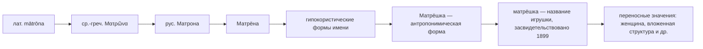
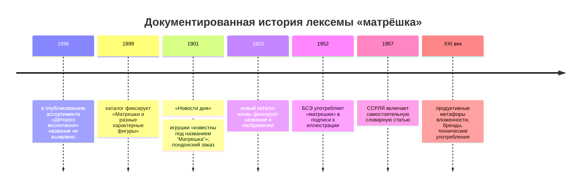
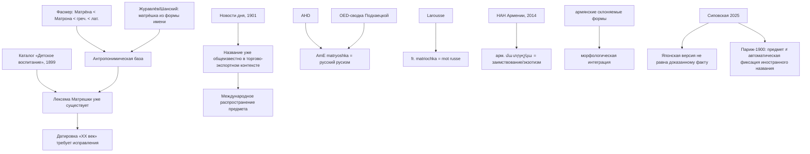

# «МАТРЁШКА»: фундаментальное источниковедческое и лексикографическое досье проекта «Русский след»

## Исполнительное резюме

Настоящее досье выполнено по исходному мастер-ТЗ проекта «Русский след», включая его требования к раздельному исследованию русского, американского английского, французского и восточноармянского, к разграничению истории вещи и истории слова, к маркировке гипотез, фиксации отрицательных результатов поиска и ведению карты доказательств. fileciteturn0file0

Главный хронологический результат исследования — необходимость пересмотреть повторяемую в этимологических словарях датировку *матрёшки* как «собственно русского образования XX в.». Академический этимологический словарь под редакцией А. Ф. Журавлёва и Н. М. Шанского действительно формулирует именно такую датировку и связывает название с личным именем *Матрёна*. Однако научные материалы 2025 года, опирающиеся на торговый каталог магазина «Детское воспитание» 1899 года, документируют форму **«Матрешки»** уже в XIX веке: «матрешки и разные характерные фигуры — 8 деревянных точеных раскрашенных кукол одна в другую». Это не просто ретроспективное воспоминание, а датированный коммерческий источник; следовательно, термин существовал и был торговым наименованием не позднее 1899 года. citeturn973476view0turn613550view0

Этимологическая цепочка в наиболее доказательной форме выглядит так: лат. *mātrōna* → среднегреч. Ματρῶνα → русское личное имя **Матрона → Матрёна** → гипокористические/уменьшительные формы имени → **Матрёшка** как имя/прозвание → вторичная номинация игрушки. Фасмер непосредственно подтверждает только звено *Матрёна < Матрона < греч. < лат.*; словарь Журавлёва—Шанского уже выводит нарицательное *матрёшка* из формы имени. Поэтому популярное объяснение «матрёшка буквально означает мать» неточно: непосредственной производящей базой является женское имя, а не современное русское *мать*. citeturn574030search0turn973476view0

История деревянной вкладывающейся игрушки существенно менее однозначна, чем история её названия. Современная источниковедческая работа Н. В. Сиповской показывает, что распространённая схема «японская фигура → Малютин нарисовал → Звёздочкин выточил → Париж-1900» содержит элементы, которые нельзя считать одинаково доказанными. Ранние японские вкладные куклы нужного типа не подтверждены; принцип «предмет в предмете» был известен и в Китае, и Европе, и России; в каталоге «Детского воспитания» 1896 года уже существовали деревянные коробки-укладки. Звёздочкин в поздней автобиографии связывал изготовление матрёшки с 1900 годом, но каталог 1899 года показывает, что изделия с этим названием уже продавались. citeturn137201view1turn613550view0

В американском английском **matryoshka** является полноценным словарным существительным. *American Heritage Dictionary* определяет его как разновидность nesting doll и прямо выводит из русского *matrëška*; американское издание *Webster’s New World*, доступное через Collins, даёт произношение `/məˈtrɔɪʃˌkə/`. OED, по лексикографическому исследованию М. Подхаецкой, датирует английскую фиксацию 1948 годом и регистрирует *matryoshka, matreshka, matrioshka*; однако эта дата сама по себе **не доказывает**, что первое употребление было именно американским. В открыто доступных материалах надёжного более раннего первого американского печатного свидетельства не обнаружено. citeturn973476view3turn835204search7turn408631view0

Во французском наиболее прочно кодифицирована форма **matriochka**, существительное женского рода. Larousse прямо маркирует его как *mot russe* и даёт *poupée russe* как синоним. Le Robert также имеет самостоятельную статью *matriochka*. Формы *matryoshka*, *matrioška* и *matrioshka* не удалось подтвердить как нормативные французские заголовочные варианты в Larousse, Le Robert, TLFi или Dictionnaire de l’Académie française; их следует рассматривать как иностранные/транслитерационные графики, пока не найдено иное доказательство. citeturn973476view4turn596912search1

В восточноармянском обнаружено важное прямое академическое свидетельство: в армяноязычной работе Института языка НАН Армении о заимствованиях и иноязычиях современного армянского форма **մատրյոշկա** включена в ряд «экзотизмов»/заимствований, обозначающих чужекультурные реалии. Это существенно сильнее простого появления русского слова в армянском тексте. Помимо этого, реальные тексты документируют морфологически оформленные формы **մատրյոշկաներ**, **մատրյոշկաների**, **մատրյոշկայի**, что свидетельствует о включении основы в армянское словоизменение. Более того, армянская публикация 2003 года цитирует русско-армянский толковый словарь 1982 года, где *մատրյոշկա* дано с описанием вложенной куклы и переносного значения о румяной женщине; однако оригинальный скан этого словаря в ходе исследования не был получен, поэтому это вторичное свидетельство. citeturn473970search12turn473970search1turn473970search11

**ГЛАВА 1. ПОЛНАЯ ХАРАКТЕРИСТИКА РУССКОГО СЛОВА**

Нормативная современная форма — **матрёшка**. «Русский орфографический словарь» фиксирует *матрёшка, -и, род. мн. -шек*; буква **ё** одновременно однозначно указывает на ударение: матр**ё**шка. Это существительное женского рода первого склонения. Основная парадигма: *матрёшка — матрёшки — матрёшке — матрёшку — матрёшкой — о матрёшке*; множественное: *матрёшки — матрёшек — матрёшкам — матрёшки/матрёшек — матрёшками — матрёшках*, причём выбор винительного множественного зависит от значения: предметное значение грамматически неодушевлённое, антропоморфное разговорное употребление допускает одушевлённую модель. citeturn121353search25turn121353search14

В Малом академическом словаре под ред. А. П. Евгеньевой основное значение — «полая внутри деревянная кукла со вставляющимися в неё такими же куклами меньшего размера». У Ожегова — «полуовальная полая разнимающаяся посередине деревянная расписная кукла», в которую вставляются меньшие. Большой толковый словарь С. А. Кузнецова развивает семантику: первое значение — предмет народного промысла; второе, с пометой **разг.**, — «о ярко накрашенной и пёстро одетой женщине», с пренебрежительным или шутливым оттенком. citeturn973476view1turn973476view2

| Семантическая зона | Статус | Доказательство |
|---|---|---|
| Вкладывающаяся расписная деревянная кукла | нормативное основное значение | МАС, Ожегов, Кузнецов citeturn973476view1turn973476view2 |
| Одна кукла из набора | нормативно/лексикографически засвидетельствовано | толковые словари citeturn973476view1 |
| Ярко накрашенная, пёстро одетая женщина | разговорное, оценочное | Кузнецов citeturn973476view2 |
| Полная, румяная, круглолицая девушка/женщина | переносное исторически засвидетельствованное | этимологический словарь приводит литературное свидетельство citeturn973476view0 |
| Грелка для чайника соответствующей формы | историческое/предметно-метафорическое | этимологический словарь с отсылкой к Л. Пантелееву citeturn973476view0 |
| «Вложенная структура» вообще | продуктивная современная метафора, но не базовое словарное значение | подтверждается русским и международным техническим/публицистическим узусом; не следует возводить в основное значение без отдельной кодификации |
| Бренд, проект, собственное имя | ономастическое вторичное употребление | требует анализа каждого имени отдельно |

Синтаксически слово ведёт себя как обычное предметное существительное: *набор матрёшек, расписать матрёшку, матрёшка из пяти фигур, принцип матрёшки*. Сочетание **принцип/эффект матрёшки** реализует модель вложенности и рекурсии; международная продуктивность этой метафоры особенно наглядна в итальянском, где Treccani отдельно описывает *effetto matrioska* как рекурсивную структуру «одно внутри другого». citeturn539220search4

Кузнецов фиксирует прилагательное **матрёшечный** (*матрёшечный промысел*). Современное словообразовательное членение целесообразно отделять от этимологии: синхронная основа — *матрёшк-*, окончание *-а*; исторически же весь комплекс связан с антропонимической деривацией от *Матрёна*. Представлять современное *-к-* просто как обычный продуктивный уменьшительный суффикс без учёта истории имени было бы упрощением. citeturn973476view2turn973476view0

Диалектологический поиск обнаружил также местное костромское употребление *матрёшка* как название тысячелистника; это не общелитературное значение и не должно смешиваться с игрушкой. Наличие такого локального омонимического/метафорического употребления показывает, что полная историческая семантика шире современной нормативной статьи, но статус его региональный. Источник: Кологривский словарь местной лексики. citeturn878931search23

Отдельная статья *матрёшка* в исходном четырёхтомном словаре Ушакова 1935–1940 в проведённом электронном поиске **не обнаружена**. Это согласуется с историко-этимологическим словарём, который считает первым самостоятельным академическим заголовочным включением статью ССРЛЯ 1957 года. Таким образом, отсутствие слова у Ушакова информативно: массовое существование лексемы к тому времени не гарантировало её включения в этот словарь. citeturn973476view0turn121353search18

Корпусная часть требует особой оговорки. Национальный корпус русского языка предоставляет поиск и механизм «распределения по годам» с нормированной частотой на миллион словоформ; однако его текущий интерактивный интерфейс не отдал через доступный исследовательский веб-интерфейс воспроизводимую числовую выгрузку именно по лемме *матрёшка*. Поэтому **числа по десятилетиям и график частотности здесь сознательно не выдумываются**. НКРЯ остаётся источником для последующего воспроизводимого экспорта; общий основной корпус на момент проверки указывает свыше 426 млн словоупотреблений. citeturn402519search0turn402519search7turn402519search16

**Корпусный статус:** наличие литературных примеров подтверждается академическими словарями, включая пример МАС из Шереметьевой и этимологические ссылки на Гладкова и Пантелеева; точная динамическая частота по периодам — **не установлена в этой сессии из-за интерфейсного ограничения НКРЯ**. Это лучше, чем подмена корпусной частотности числом поисковых результатов. citeturn973476view1turn973476view0

## Русская этимология и история наименования

**ГЛАВА 2. ЭТИМОЛОГИЯ И СЛОВООБРАЗОВАНИЕ**

Фасмер не имеет отдельного заголовка *матрёшка* в доступном алфавитном массиве, но его статья **Матрёна** принципиально важна: *Матрёна* трактуется как гипокористическая форма вместо более старого *Матрона*, через среднегреческое Ματρῶνα от латинского *mātrōna*. Таким образом, этимологическая глубина слова уходит в антропоним, а не непосредственно в предметную лексику русского ремесла. citeturn574030search0turn574030search7

Этимологический словарь русского языка МГУ под ред. Журавлёва и Шанского делает следующий шаг: нарицательная *матрёшка* возникла «на базе Матрёшка» как формы имени, связанной с *Матрёна*. Он сопоставляет модель с *петрушка < Петрушка < Петруша*. Это сильное лексикографическое свидетельство антропонимического происхождения названия. citeturn973476view0

Однако в той же статье содержится уже устаревший хронологический вывод: «собственно рус. образование XX в.». Документ 1899 года делает эту формулировку неприемлемой в буквальном виде. Следовательно, следует разделить два компонента статьи: **этимологическая связь с Матрёной остаётся хорошо поддержанной, датировка XX в. опровергается более ранним документом**. citeturn973476view0turn613550view0

Не доказана популярная семантическая легенда, будто куклу назвали *матрёшкой* именно потому, что имя Матрёна ассоциировалось с «матерью большого семейства», плодовитостью или дородностью. *American Heritage Dictionary* повторяет такую культурную ассоциацию, но это объясняет возможную мотивацию, а не документирует акт называния. На сегодняшний день нет найденного источника конца XIX века вида «мы дали игрушке имя Матрёшка потому, что…». Следовательно, **формальная антропонимическая этимология — сильная; конкретная психологическая мотивация выбора имени — гипотетическая**. citeturn973476view3turn613550view0

Этимологическую цепочку можно представить так:

Эта диаграмма соединяет только звенья различной степени доказанности: A–D прямо подтверждены Фасмером; D–G — академической этимологией и историческим каталогом; конкретная промежуточная бытовая форма между *Матрёна* и *Матрёшка* в реальном акте именования игрушки не документирована современным ему свидетельством. citeturn574030search0turn973476view0turn613550view0

**ГЛАВА 3. ИСТОРИЯ СЛОВА «МАТРЁШКА»**

Наиболее раннее **обнаруженное в настоящем исследовании датированное употребление именно названия игрушки** относится к каталогу магазина «Детское воспитание» 1899 года. Научная публикация материалов Международного конгресса РГХПУ им. С. Г. Строганова 2025 года указывает: в каталоге 1896 года матрёшка ещё не значится; каталоги 1897–1898 пока не обнаружены; каталог 1899 года уже содержит «матрешки и разные характерные фигуры». Это устанавливает терминологический интервал: **после каталога 1896 и не позднее каталога 1899**, если не найдётся более ранний независимый текст. citeturn613550view0

Отдельная цифровая публикация того же каталога сообщает библиотечный шифр РНБ **18.146.3.767(1899-1)** и воспроизводит позицию № 45. Поскольку веб-публикация вторична по отношению к самому экземпляру РНБ, её нельзя считать эквивалентом прямого просмотра оригинала; однако её сведения согласуются с независимой академической публикацией 2025 года. citeturn551359search0turn613550view0

В 1901 году газета «Новости дня» уже говорит о партии игрушек, «известных под названием “Матрешка”», заказанной для Лондона. Это особенно ценно для истории **названия**, потому что подтверждает, что к 1901 году оно воспринималось как закреплённое товарное обозначение, а не просто имя одного конкретного экземпляра. citeturn137201view0turn313244view0

Хронология названия:

Решающая методологическая граница: **Парижская выставка 1900 года подтверждает присутствие изделия, но сама по себе не подтверждает употребления французского слова *matriochka* в 1900 году**. Сиповская прямо отмечает отсутствие отдельного комментария о матрёшке в русском каталоге отдела и в развернутом современном описании выставки; французская фиксация названия должна датироваться отдельно. citeturn137201view0turn137201view1

## Приоритетные языки заимствования

**ГЛАВА 4. АМЕРИКАНСКИЙ АНГЛИЙСКИЙ**

Американская словарная норма надёжно подтверждает **matryoshka**. *American Heritage Dictionary* даёт заголовок *ma·try·osh·ka*, существительное, и определяет его как одну из вкладывающихся кукол набора, оформленную как женщина в традиционной русской одежде. Этимология прямо ведёт к рус. *matrëška*, далее к имени *Matrëna*. Следовательно, это не описательная калька, а графически адаптированное русское заимствование. citeturn973476view3

Американское *Webster’s New World College Dictionary*, доступное в Collins, даёт **matryoshka / matryoshka doll** и американское произношение `/məˈtrɔɪʃˌkə/`. В том же ресурсе британская статья имеет `/ˌmætrɪˈɒʃkə/` и перечисляет *matrioshka* и ошибочно/вариантно переставленное *matroyshka*. Это наглядно показывает, почему американское и британское произношение нельзя смешивать. citeturn835204search7

| Параметр | Американский английский |
|---|---|
| Основная форма | **matryoshka** citeturn973476view3 |
| Составное обозначение | **matryoshka doll** citeturn835204search7 |
| Исторические/графические варианты | *matreshka, matrioshka*; OED2-материал фиксирует их рядом с *matryoshka* citeturn408631view0 |
| Часть речи | count noun |
| Множественное | обычное англ. *matryoshkas*; также встречается русифицированное *matryoshki*, но оно не является основной английской парадигмой |
| Американское произношение | `/məˈtrɔɪʃˌkə/` по Webster’s New World/Collins citeturn835204search7 |
| Значение | Russian nesting doll / один элемент такого набора |
| Источник | рус. *матрёшка* |
| Интеграция | высокая лексическая, но сохраняется культурная маркированность |

Исследование Подхаецкой, систематически сравнивающее OED и словари Webster с корпусами, помещает *matryoshka, matreshka, matrioshka* под датой **1948**; в BNC оно находит *matryoshka* и русифицированное множественное *matrioshki*. Это надёжно подтверждает английскую историю вариантов, но не позволяет автоматически назвать 1948 год «первым американским употреблением»: таблица относится к OED-датировке английского вообще. citeturn408631view0turn606888view0

Прямой OED URL проверен, но сайт требует JavaScript/антибот-проверку, поэтому полная текущая статья не была непосредственно прочитана. Merriam-Webster по прямому адресу в инструментальном доступе также не открылся. Следовательно, требование мастер-ТЗ по этим двум ресурсам выполнено с указанием **ограничения доступа**, а не с выдуманной словарной статьёй. citeturn593196view1turn593196view0

Для американского употребления 1990-х имеются прямые документальные примеры: журнал *Russian Life* писал о *matryoshka nesting dolls*, *matryoshki* и *matroshki* в контексте американской торговли русскими сувенирами и называл магазины в Бостоне, Нью-Йорке, Чикаго и Сан-Франциско. Это подтверждает живую вариативность заимствования в США, но не его первую фиксацию. citeturn835204search3

**Russian nesting doll** — прозрачное английское описательное обозначение, а не русизм. **Russian doll** — более короткий эквивалент. **Babushka doll** нельзя этимологически приравнивать к *matryoshka*: английское *babushka* заимствовано из другого русского слова и в данном сочетании выполняет вторичную этнокультурную маркировку. Следовательно, для базы «Русский след» собственно продолжателями *матрёшка* являются графические формы типа *matryoshka/matrioshka/matreshka*, но не *Russian nesting doll*. citeturn835204search7turn973476view3

**ГЛАВА 5. ФРАНЦУЗСКИЙ ЯЗЫК**

В современном французском наиболее сильная словарная фиксация — **matriochka**, *nom féminin*. Larousse прямо маркирует происхождение как **mot russe** и определяет слово как деревянную *poupée gigogne*, внутри которой находятся уменьшающиеся одинаковые куклы; нормативным синонимом даётся *poupée russe*. citeturn973476view4

Le Robert также имеет самостоятельный заголовок *matriochka* и использует слово не только предметно, но и в примерах метафорической вложенности. Его страница во время повторного открытия дала 403, поэтому содержание опирается на поисковую индексацию, а не на полный повторный просмотр страницы. citeturn596912search1turn973476view5

Французская графика показывает характерную национальную адаптацию русского сочетания **ёшк / jošk/** через **iochka**: *matr-io-ch-ka*. В отличие от английского *-yoshka*, французская орфография использует *ch* для /ʃ/. Это не доказательство посредничества французского при заимствовании в другие языки: сходство графики само по себе не устанавливает цепочку передачи. citeturn973476view4

Форма женского рода морфологически интегрирована: **une matriochka**, обычное французское множественное **des matriochkas**. Канадский официальный Grand dictionnaire terminologique OQLF также фиксирует *matriochka, n. f.* наряду с *poupée russe*. Это дополнительное франкоязычное подтверждение, хотя географически оно относится к Квебеку, а не к Франции. citeturn596912search2

По общественному Wiktionnaire произношение передаётся как `/ma.tʁi.jɔʃ.ka/`; однако Larousse в доступном текстовом представлении IPA не показывает, а академический TLFi-заголовок по выполненному поиску не обнаружен. Поэтому французскую IPA-транскрипцию следует маркировать как **доказательство более низкого уровня**, чем словарные данные Larousse о написании, роде и происхождении. citeturn596912search5turn725544search3

Поиск по TLFi/CNRTL и Dictionnaire de l’Académie française не выявил самостоятельной статьи *matriochka* в доступной индексации. Это нельзя превращать в утверждение «слово отсутствует во всех академических изданиях»: корректная формулировка — **не обнаружено данным способом поиска**. Larousse и Le Robert, напротив, подтверждают современную кодификацию без сомнений. citeturn725544search3turn725544search4turn596912search11

Формы *matrioška*, *matryoshka*, *matrioshka* как нормативные варианты французского заголовка в проверенных Larousse/Robert/TLFi/Académie **не подтверждены**. Их нельзя включать в сравнительную таблицу как равноправные французские нормы только потому, что они встречаются в международной латинице.

**ГЛАВА 6. ВОСТОЧНОАРМЯНСКИЙ ЯЗЫК**

Наиболее важная находка — армянская форма **մատրյոշկա**. Она не была предположена заранее, а обнаружена в армяноязычной научной публикации Института языка НАН Армении: Լուիզա Մելքոնյան, «Փոխառություններ և օտարաբանություններ արդի հայերեն խոսքում» («Заимствования и иноязычия в современной армянской речи»), материалы республиканской конференции молодых лингвистов, Ереван, 2014. Автор перечисляет **մատրյոշկա** среди культурно специфических слов-реалий и обсуждает подобные единицы как заимствования/экзотизмы, часто не имеющие точного армянского эквивалента. citeturn473970search12

Это позволяет классифицировать **մատրյոշկա** как документированную заимствованную единицу восточноармянского письменного узуса, а не только как русское вкрапление. При этом единственная научная статья недостаточна для утверждения, что слово полностью нейтрально или общеупотребительно во всех регистрах.

Сильный дополнительный материал даёт армянская пресса. Hetq в 2003 году приводит словарное определение из «Русско-армянского толкового словаря», Ереван, 1982: *Մատրյոշկա* — вложенная деревянная кукла; второе значение — о румяной здоровой женщине/девушке. Поскольку оригинал словаря 1982 года не был непосредственно просмотрен, этот источник имеет статус **вторичной документальной цитаты**, а не проверенной оригинальной словарной страницы. citeturn473970search1

Реальное словоизменение подтверждается текстами:

| Форма | Засвидетельствованная функция | Что показывает |
|---|---|---|
| **մատրյոշկա** | словарная/начальная | заимствованная основа citeturn473970search12 |
| **մատրյոշկաներ** | множественное число | присоединение арм. мн. суффикса -ներ citeturn473970search3turn473970search4 |
| **մատրյոշկաների** | род.-дат. мн. | полноценное падежное оформление citeturn473970search1 |
| **մատրյոշկայի** | род.-дат. ед. | падежная интеграция основы citeturn473970search11 |
| **մատրյոշկան** | определённая форма ед. | присоединение армянского определённого показателя citeturn473970search11 |

Таким образом, по критерию морфологии слово **существенно освоено**: к русской заимствованной основе продуктивно присоединяются восточноармянские грамматические показатели. Это сильнее, чем единичное несклоняемое цитатное употребление. citeturn473970search1turn473970search11

Надёжная IPA из армянского академического произносительного источника не обнаружена; поэтому она **не реконструируется в качестве словарного факта**. Графически очевидно соответствие рус. *матрёшка* → арм. *մատրյոշկա* с передачей русской последовательности через армянский алфавит, но точные аллофонические значения и место ударения без специального источника в досье не догматизируются.

Портал Lezu предоставляет доступ к большому массиву армянских словарей, включая толковые и орфографические издания, но при выполненном поиске не удалось получить проверяемую скан-страницу академического толкового словаря с отдельным заголовком **մատրյոշկա**. Поэтому корректный вывод: **слово академически обсуждается как заимствование и реально склоняется в восточноармянском; отдельная современная академическая заголовочная статья непосредственно не обнаружена**. citeturn973476view6

## Другие языки и сравнительная система

**ГЛАВА 7. ДРУГИЕ ЯЗЫКИ**

Включены только случаи, где источник прямо связывает форму с русским, а не просто обозначает ту же игрушку.

| Язык | Форма | Грамматика/произношение | Доказательство русского происхождения |
|---|---|---|---|
| Немецкий | **Matroschka**, варианты *Matrioschka*, реже *Matrjoschka* | ж.р.; pl. *Matroschkas*; для *Matrjoschka* Duden даёт `[matriˈɔʃka]` | Duden прямо указывает русскую основу; вариантность кодифицирована citeturn539220search1turn539220search2turn539220search3 |
| Итальянский | **matrioska** | s. f.; Treccani: ‹matriòska› | Treccani: «adattamento fonetico e grafico del russo matrëška» citeturn539220search0 |
| Греческий | **ματριόσκα** | `[matrioska]` в исследуемом словаре | EURALEX: Academy of Athens UD относит её к прямым русским заимствованиям; указано `< Rus. matrëshka` citeturn408631view1turn606888view1 |

Особенно ценно греческое свидетельство, поскольку статья EURALEX не просто констатирует форму, а анализирует происхождение в двух академических словарях. В User’s Dictionary Академии Афин *ματριόσκα* входит в группу прямых русских заимствований; рядом приводится английская параллель *matrioshka* с датой 1964, но сама статья подчёркивает русское исходное слово. citeturn408631view1

Немецкий материал показывает далеко зашедшую орфографическую адаптацию: Duden предпочитает **Matroschka**, допускает **Matrioschka** как Nebenform и **Matrjoschka** как более редкое. При этом этимологическое объяснение Duden, связывающее слово непосредственно с рус. *мать*, выглядит менее точным, чем русская антропонимическая этимология через *Матрёна*; это отдельный пример того, как принимающий словарь может упрощать этимон. citeturn539220search1turn574030search0

Treccani, напротив, точно разделяет уровни: итал. *matrioska* — фонетико-графическая адаптация рус. *matrëška*, которое, вероятно, является фамильярным уменьшением имени *Matrëna*, восходящего к лат. *matrona*. Treccani также датирует заметное появление слова в итальянской периодике 1968 годом и документирует продуктивную метафору *effetto matrioska*. citeturn539220search0turn539220search4

Испанский, польский, чешский, турецкий, японский и китайский проверялись как кандидаты, однако в рамках доступного поиска не удалось собрать одновременно достаточное количество **первичных/академических доказательств прямого русского происхождения**, поэтому они сознательно не добавлены в таблицу как «доказанные» только на основании Wiktionary/переводных сайтов. Это соответствует критерию мастер-ТЗ: сходство формы не равно доказанному пути заимствования.

**ГЛАВА 8. СРАВНИТЕЛЬНЫЙ АНАЛИЗ**

| Параметр | Русский | AmE | Французский | Восточноармянский |
|---|---|---|---|---|
| Нормативная/главная форма | матрёшка | matryoshka | matriochka | մատրյոշկա |
| Графика | кириллица, ё | латиница; *yo* передаёт ё/йо-комплекс | *io + ch* отражает французскую графику | армянский алфавит |
| Род | ж. | рода нет | féminin | грамм. род как категория существительных не сопоставим с рус./фр. |
| Число | матрёшки | matryoshkas | matriochkas | մատրյոշկաներ |
| Словоизменение | богатая падежная парадигма | в основном -s | -s во мн. письменно | армянские показатели числа, падежа, определённости |
| Основное значение | русская вкладная кукла | Russian nesting doll | poupée gigogne russe | та же русская культурная реалия |
| Переносное значение «женщина» | словарно подтверждено | не выявлено как стандартное | не основной словарный смысл | вторично цитируется по словарю 1982 |
| Метафора вложенности | продуктивна | продуктивна в терминологии/публицистике | продуктивна | реально засвидетельствована в политической метафоре |
| Степень освоения | исходная лексема | высокая, но культурно маркированная | высокая | морфологически высокая; лексикографическая кодификация менее прозрачна |
| Достоверная IPA | аналитически ≈ `[mɐˈtrʲɵʂkə]` | `/məˈtrɔɪʃˌkə/` по WNW | общественный источник `/ma.tʁi.jɔʃ.ka/` | академическая IPA не обнаружена |

Графическая адаптация особенно показательна. Англ. **yosh** стремится сохранить для англоязычного читателя последовательность, близкую русской *ёш*; франц. **ioch** использует национальную диграфию *ch* = /ʃ/; арм. **յոշկ** передаёт структуру русской основы средствами собственной письменности. Немецкий **-oschka/-ioschka/-joschka** демонстрирует сразу несколько конкурирующих способов передачи. citeturn973476view3turn973476view4turn539220search1turn539220search3

Фонетически русская палатализация /rʲ/ и гласный после неё не сохраняются тождественно. В американской словарной реализации наблюдается переинтерпретация центральной части как `/trɔɪʃ/`; во французском — последовательность с /jɔʃ/; в немецком редкий вариант Duden имеет `[matriˈɔʃka]`. Поэтому одинаковая этимология не приводит к одинаковой фонетической адаптации. citeturn835204search7turn539220search3

Семантическая картина показывает преимущественное **сужение при заимствовании**: принимающие языки заимствуют прежде всего культурно-реалионное значение «русская вложенная кукла», а разговорное русское значение «ярко накрашенная женщина» обычно не становится базовым. Позднее независимо развивается международная метафора вложенности. citeturn973476view2turn539220search4

По грамматической интеграции французский и немецкий сразу присваивают слову род; английский включает его в обычную count-noun модель; армянский особенно наглядно демонстрирует интеграцию посредством форм *մատրյոշկաներ, մատրյոշկաների, մատրյոշկայի*. citeturn973476view4turn539220search1turn473970search1turn473970search11

Мера распространённости должна основываться на корпусах, а не интуитивной шкале 1–10. Для английского BNC-исследование Подхаецкой на историческом срезе нашло всего несколько токенов (*matryoshka* — 3 плюс варианты), что указывает на сравнительно редкую культурную лексику в том корпусе; это нельзя напрямую переносить на современный американский английский. Для французского и армянского сопоставимые нормированные корпусные числа не получены. citeturn408631view0

## История предмета, международное распространение и научные споры

**ГЛАВА 9. ИСТОРИКО-КУЛЬТУРНЫЙ КОНТЕКСТ**

Историю предмета необходимо строить независимо от этимологии. Современное искусствоведческое исследование показывает, что мастерская «Детское воспитание» существовала в контексте художественного возрождения русской игрушки и экспериментов с токарными изделиями. В её каталоге 1896 года уже были «коробки одна в другую», то есть сама технология вложенности присутствовала до первой обнаруженной фиксации слова *матрёшка*. citeturn137201view1

Версия о японском Фукурокудзю остаётся частью историографии, но не может излагаться как доказанный единственный генезис. Сиповская отмечает отсутствие известных ранних японских примеров именно вкладных кукол нужного типа и наличие более старой китайской традиции «предмет в предмете», а также европейских и русских изделий этого принципа. Следовательно, японское влияние **возможно**, но формула «матрёшка — копия японской куклы» источниковедчески чрезмерна. citeturn137201view1

Авторство С. В. Малютина также нуждается в осторожной формулировке. Более поздняя музейная и научная традиция связывает художественное решение первой известной куклы с Малютиным, токарное исполнение — со Звёздочкиным; однако документальные свидетельства времени создания фрагментарны, а поздние мемуары противоречат друг другу. Научные материалы 2025 года даже приводят альтернативные воспоминания о возможном участии В. А. Серова и тут же подчёркивают, что они записаны только в 1940-е годы и требуют оговорки. citeturn613550view0

Париж 1900 важен для **экспорта предмета**, но не служит автоматической датой появления иностранного слова. Сиповская показывает, что Мария Мамонтова получила бронзовую награду в классе игрушечного производства, а описание международного жюри действительно соответствует вкладывающейся фигуре; при этом современная выставочная литература не выделяла *матрёшку* отдельным русским названием. citeturn137201view0turn613550view0

В 1901 году заказ из Лондона уже сопровождается русским названием в российской газете; в 1904 году упоминается экспортный заказ из Парижа. Но даже это доказывает экспорт и русское употребление, а не автоматически английскую форму *matryoshka* или французскую *matriochka* в языке заказчика. citeturn137201view0

**ГЛАВА 10. НАУЧНЫЕ ПРОТИВОРЕЧИЯ**

| Спорный вопрос | Позиция/данные A | Позиция/данные B | Оценка |
|---|---|---|---|
| Когда возникло слово? | этимологический словарь: XX в. citeturn973476view0 | каталог 1899: *Матрешки* citeturn613550view0 | датировка «XX в.» опровергнута; terminus ante quem — 1899 |
| Первая ли фиксация 1899? | пока самый ранний найденный каталог | каталоги 1897–1898 не обнаружены | «самая ранняя найденная», не «абсолютно первая» |
| Происходит ли название от Матрёны? | Фасмер + Журавлёв/Шанский + AHD подтверждают | прямого документа об акте называния нет | этимология сильная; мотив выбора имени не документирован |
| Японское ли происхождение игрушки? | популярная версия о японском образце | исследование 2025 указывает на более сложную евразийскую традицию и отсутствие ранних японских вкладных образцов | японское влияние возможно, но не доказано как единственный источник |
| Автор Малютин? | традиционная атрибуция | поздние воспоминания и отсутствие прямого раннего документа | вероятная, но не абсолютная атрибуция |
| Дата английского заимствования | OED: 1948 | первая именно американская фиксация не установлена | 1948 — английская OED-дата, не доказанный «первый US» |
| Французские варианты | Larousse/Robert: *matriochka* | международные *matryoshka/matrioshka* | нормативно доказана прежде всего *matriochka* |
| Армянский статус | научная статья квалифицирует *մատրյոշկա* как заимствование/экзотизм | отдельная заголовочная статья академического толкового словаря непосредственно не найдена | заимствование доказано; степень словарной кодификации требует дальнейшего первичного просмотра |

Особенно важна методологическая асимметрия доказательств: для **названия** имеется датированный каталог 1899 года; для «кто придумал идею» мы в значительной мере зависим от позднейших воспоминаний и реконструкций. Поэтому история слова на данном этапе документирована надёжнее, чем авторская легенда о возникновении конструкции. citeturn613550view0turn137201view1

## Карта доказательств и реестр

**ГЛАВА 11. КАРТА ДОКАЗАТЕЛЬСТВ**

Ключевые доказательства классифицируются так:

| Утверждение | Категория | Источник | Ограничение |
|---|---|---|---|
| *Матрешки* засвидетельствовано в 1899 | **прямое подтверждение** | [S8], [S9] | оригинал РНБ непосредственно через интерфейс не просмотрен |
| Название связано с именем Матрёна | **прямое лексикографическое подтверждение** | [S5], [S6] | мотив выбора именно этого имени не зафиксирован современным документом |
| Русская статья «XX в.» устарела | **обоснованный аналитический вывод** | [S5] + [S8]/[S9] | зависит от правильности датировки каталога |
| Первая игрушка была копией японской | **гипотеза/популярная версия** | критически разбирается [S10] | прямое доказательство цепочки отсутствует |
| AmE *matryoshka* — русизм | **прямое подтверждение** | [S11] | первая американская дата не установлена |
| Английская датировка 1948 | **прямое лексикографическое подтверждение для English/OED** | [S13] | не тождественна первой дате США |
| fr. *matriochka* — русизм, ж.р. | **прямое подтверждение** | [S16], [S17] | TLFi/Académie отдельная статья не обнаружена |
| арм. *մատրյոշկա* — заимствование | **прямое научное подтверждение** | [S21] | степень общеязыковой частотности не измерена |
| армянское морфологическое освоение | **обоснованный вывод из текстовых форм** | [S22] + тексты | нет полного корпусного частотного профиля |
| точная частотность НКРЯ по периодам | **не установлено** | [S7] | интерактивная выгрузка недоступна через используемый интерфейс |

**ГЛАВА 12. ПОЛНЫЙ РЕЕСТР ИСТОЧНИКОВ**

[S1] **Русский орфографический словарь**, под ред. В. В. Лопатина, О. Е. Ивановой; нормативная форма *матрёшка*. Русский.  
https://gramota.ru/storage/public/normdicts/orfograficheskij_slovar.pdf citeturn121353search25

[S2] **Ожегов С. И., Шведова Н. Ю. Толковый словарь русского языка**, электронная републикация; предметное значение. Русский.  
https://www.lib.ru/DIC/OZHEGOW/ozhegow_m_o.txt citeturn878931search27

[S3] **Словарь русского языка / под ред. А. П. Евгеньевой (МАС)**, электронная републикация статьи; грамматика, значение, литературный пример. Русский.  
https://lexicography.online/explanatory/%D0%BC/%D0%BC%D0%B0%D1%82%D1%80%D1%91%D1%88%D0%BA%D0%B0 citeturn973476view1

[S4] **Кузнецов С. А. Большой толковый словарь русского языка**, электронная републикация; два значения, пометы, производное *матрёшечный*. Русский.  
https://gufo.me/amp/dict/kuznetsov/%D0%BC%D0%B0%D1%82%D1%80%D0%B5%D1%88%D0%BA%D0%B0 citeturn973476view2

[S5] **Этимологический словарь русского языка. Вып. 10: М / под общ. ред. А. Ф. Журавлёва и Н. М. Шанского. МГУ, 2007.** Ключевая статья *Матрёшка*; связь с Матрёной; устаревшая датировка XX в.; вторичные значения. Русский.  
https://www.slovorod.ru/etym-shansky/esrja-mgu/_pdf/red-shanski-10.pdf citeturn973476view0

[S6] **Фасмер М. Этимологический словарь русского языка: Матрёна.** Антропонимическая цепочка *Матрёна < Матрона < Ματρῶνα < mātrōna*. Русский.  
https://lexicography.online/etymology/vasmer/%D0%BC/%D0%BC%D0%B0%D1%82%D1%80%D1%91%D0%BD%D0%B0 citeturn574030search0

[S7] **Национальный корпус русского языка.** Корпусный поиск и распределение по годам; количественный экспорт по лемме в используемом интерфейсе не получен. Русский.  
https://ruscorpora.ru/search citeturn402519search0

[S8] **«Каталог изданий А. И. Мамонтова и магазина “Детское воспитание”, сентябрь 1899»**, цифровая публикация сканов с указанием шифра РНБ 18.146.3.767(1899-1). Русский; вторичная цифровая подача первичного документа.  
https://matreshka.site/pervoe-upominanie-matryoshki-sentyabr-1899-goda/ citeturn551359search0

[S9] **Материалы Международного конгресса «Сохранение культурного наследия народных художественных промыслов России», РГХПУ им. С. Г. Строганова, 2025.** Научное подтверждение каталога 1899, разбор атрибуций, Парижа-1900. Русский.  
https://xn----7sbabalfgj4as1arld1aqs8v.xn--p1ai/uploads/catalogfiles/9617_2025_kongress_nxp-2.pdf citeturn712711view0turn613550view0  
Примечание: текст PDF извлечён; запрос отдельного скриншота релевантной страницы вернул 502.

[S10] **Сиповская Н. В. «Матрешка: студийное творчество и народная традиция». Художественная культура. 2025. № 4. С. 300–353.** DOI 10.51678/2226-0072-2025-4-300-353. Критическая история происхождения предмета, Парижа, экспортных заказов. Русский.  
https://artculturestudies.sias.ru/upload/iblock/4b5/saf1ozw1ex5qol1z8x2sumag7skj36gf/hk_2025_4_300.pdf citeturn408631view2turn313244view0

[S11] **The American Heritage Dictionary of the English Language, Fifth Edition: matryoshka.** Американский английский; форма, определение, этимология, словарное произношение. Английский.  
https://ahdictionary.com/word/search.html?q=matryoshka citeturn973476view3

[S12] **Collins / Webster’s New World College Dictionary: matryoshka.** Американское и британское произношения, варианты, *matryoshka doll*. Английский.  
https://www.collinsdictionary.com/dictionary/english/matryoshka citeturn835204search7

[S13] **Podhajecka, M. Russian Borrowings in English: A Dictionary and Corpus Study.** Сводные данные OED/Webster/BNC; дата 1948 и варианты *matryoshka, matreshka, matrioshka*. Английский.  
https://repo.uni.opole.pl/docstore/download/UOc7715a6399334ccd97b00bd1de5c3516/PodhajeckaM-Russianborrowings.pdf citeturn408631view0turn606888view0

[S14] **Oxford English Dictionary: matryoshka.** Прямой адрес статьи; текущий просмотр блокируется JavaScript/антибот-механизмом, поэтому содержание проверялось косвенно через [S13]. Английский.  
https://www.oed.com/dictionary/matryoshka_n citeturn593196view1

[S15] **Merriam-Webster: предполагаемый прямой словарный URL matryoshka.** Через исследовательский инструмент страница оказалась недоступна; сведения из неё не приписывались словарю. Английский.  
https://www.merriam-webster.com/dictionary/matryoshka citeturn593196view0

[S16] **Larousse: matriochka.** *Nom féminin, mot russe*, определение и синоним *poupée russe*. Французский.  
https://www.larousse.fr/dictionnaires/francais/matriochka/49913 citeturn973476view4

[S17] **Le Robert: matriochka.** Французская словарная статья; повторный полный fetch ограничен 403. Французский.  
https://dictionnaire.lerobert.com/definition/matriochka citeturn596912search1turn973476view5

[S18] **TLFi / ATILF.** Академическая французская база; отдельный заголовок *matriochka* при выполненном поиске не найден. Французский.  
https://www.atilf.fr/ressources/tlfi/ citeturn725544search3

[S19] **Dictionnaire de l’Académie française.** Проверен как нормативный академический ресурс; отдельная статья в поиске не обнаружена. Французский.  
https://www.dictionnaire-academie.fr/ citeturn596912search11

[S20] **Office québécois de la langue française, Grand dictionnaire terminologique: matriochka.** *n. f.*, параллель *poupée russe*. Французский (Квебек).  
https://vitrinelinguistique.oqlf.gouv.qc.ca/fiche-gdt/fiche/17020362/matriochka citeturn596912search2

[S21] **Մելքոնյան Լուիզա. «Փոխառություններ և օտարաբանություններ արդի հայերեն խոսքում»**, Институт языка НАН Армении, 2014. Прямое армяноязычное научное свидетельство *մատրյոշկա* как заимствованной культурной реалии. Армянский.  
https://language.sci.am/sites/default/files/book/eritasard_lezvabanner.pdf citeturn473970search12

[S22] **Hetq, 16.02.2003, «Ընտրություններ մեծ ու փոքր մատրյոշկաների միջեւ».** Армянский текст с формами словоизменения и цитатой русско-армянского толкового словаря 1982 года. Армянский.  
https://hetq.am/hy/article/6832 citeturn473970search1

[S23] **Lezu.am — հայերեն բառարաններ.** Портал армянских словарных ресурсов; использован для проверки доступной лексикографической базы. Армянский.  
https://www.lezu.am/ citeturn973476view6

[S24] **Duden: Matroschka / Matrioschka / Matrjoschka.** Немецкая орфография, род, множественное число, вариантность и частично IPA. Немецкий.  
https://www.duden.de/rechtschreibung/Matroschka  
https://www.duden.de/rechtschreibung/Matrioschka  
https://www.duden.de/rechtschreibung/Matrjoschka citeturn539220search1turn539220search2turn539220search3

[S25] **Treccani: matrioska.** Итальянская форма, женский род, русская этимология и фонетико-графическая адаптация. Итальянский.  
https://www.treccani.it/vocabolario/matrioska/ citeturn539220search0

[S26] **EURALEX 2018, “Russian Borrowings in Greek and Their Presence in Two Greek Dictionaries”.** Греческая *ματριόσκα*, русское происхождение, сведения словаря Академии Афин. Английский/греческий.  
https://euralex.org/wp-content/themes/euralex/proceedings/Euralex%202018/118-4-2999-1-10-20180820.pdf citeturn408631view1turn606888view1

[S27] **Russian Life, “From Amerika with Love”, 1996.** Документирует варианты *matryoshka, matryoshki, matroshki* в американской торговле русскими сувенирами. Английский (США).  
https://www.russianlife.com/magazine/november-1996/from-amerika-with-love/ citeturn835204search3

## Информационные пробелы и дополнительные результаты

**ГЛАВА 13. НЕРЕШЁННЫЕ ВОПРОСЫ**

Первый пробел — абсолютная первая письменная фиксация русского слова. На сегодняшний день наиболее раннее найденное доказательство — каталог 1899 года; но отсутствие каталогов 1897–1898 означает, что датировать **возникновение** слова 1899 годом нельзя. Научно корректная формула: *лексема документирована не позднее 1899 года; более ранняя фиксация пока не обнаружена*. citeturn613550view0

Второй пробел — непосредственный первоисточник акта называния. Нет документа конца XIX века, устанавливающего, кто именно предложил имя *Матрёшка*, в какой момент и почему. Позднейшие воспоминания о Серове, Малютине, Звёздочкине и Мамонтовых важны, но не равноценны современному событию документу. citeturn613550view0

Третий — первая **американская**, а не общеанглийская фиксация. OED-датировка 1948 года документирована через специальное исследование, но географическую принадлежность самой цитаты в доступном материале установить не удалось. Поэтому утверждение «в США с 1948» было бы чрезмерным. citeturn408631view0

Четвёртый — французская историческая датировка. Современная форма *matriochka* надёжно кодифицирована, но первая французская печатная фиксация не установлена по Gallica/TLFi в достаточной степени, чтобы назвать конкретный год. Парижская выставка 1900 года не заполняет этот пробел, поскольку наличие игрушки ≠ наличие французского слова. citeturn973476view4turn137201view0

Пятый — армянская академическая заголовочная статья и произношение. Форма *մատրյոշկա* доказана научным текстом и реальным словоизменением, но первичный скан словаря 1982 года, современная академическая словарная статья и авторитетная IPA не были обнаружены. Поэтому морфологическая интеграция доказана лучше, чем орфоэпическая кодификация. citeturn473970search12turn473970search1

Шестой — точные сопоставимые корпусные частоты. Для русского динамический интерфейс НКРЯ не позволил получить воспроизводимую таблицу по годам; для AmE требовалась бы отдельная выгрузка COCA/COHA; для французского — Frantext или сопоставимый корпус; для армянского — специализированный репрезентативный корпус. Поэтому **никакого условного рейтинга «8/10» не присваивалось**. citeturn402519search0

**ГЛАВА 14. ДОПОЛНИТЕЛЬНЫЕ ИССЛЕДОВАТЕЛЬСКИЕ НАХОДКИ**

Наиболее значимая дополнительная находка — историческая асимметрия между словарями и документом. Академическая этимология 2007 года сохраняла датировку XX в., несмотря на существование каталога 1899 года; это показывает, что для поздних культурных слов **торговые каталоги, музейные описи и рекламные материалы могут оказаться хронологически информативнее традиционных этимологических словарей**. citeturn973476view0turn613550view0

Вторая находка — название было коммерчески множественным почти сразу: каталог говорит не об уникальной «Матрёшке» как имени одной фигурки, а о **«Матрешках»** как категории товара. Это усиливает аргумент, что к 1899 году уже произошла апеллятивизация антропонима: собственное имя функционировало как нарицательное название типа изделия. citeturn613550view0

Третья — экспортная история показывает разрыв между **культурной диффузией вещи** и **лексическим заимствованием**. Русское слово засвидетельствовано в торговом русском контексте 1899–1901 годов, но английские и французские формы требуют своих самостоятельных датировок. Именно поэтому нельзя строить цепочку «Париж 1900 → французское *matriochka* в 1900» без французского текста. citeturn137201view0turn408631view0

Четвёртая — восточноармянский материал особенно убедителен не самим графическим совпадением, а **морфологией**: формы *մատրյոշկաներ, մատրյոշկաների, մատրյոշկայի* демонстрируют, что слово уже не просто цитируется по-русски, а принимает армянские показатели числа и падежа. Для теории заимствований это более сильный критерий интеграции, чем единичное появление неизменяемой формы. citeturn473970search1turn473970search11

Пятая — международные системы адаптации образуют несколько устойчивых графических типов: англ. **-yoshka**, франц. **-iochka**, итал./греч. **-ioska**, нем. **-oschka/-ioschka/-joschka**, арм. **-յոշկա**. Это не хаотические ошибки транслитерации, а решения, мотивированные национальными орфографическими системами; в ряде языков конкурирующие решения впоследствии кодифицируются как варианты. citeturn973476view3turn973476view4turn539220search0turn539220search1turn408631view1

Итоговая доказательная формула для словарного проекта может быть сформулирована предельно строго: **матрёшка** — русское нарицательное название, образованное на базе женского имени *Матрёна* и документированное как название вкладывающейся деревянной игрушки не позднее 1899 года; в XX–XXI веках оно было непосредственно заимствовано и графически адаптировано, по меньшей мере, в американском английском (*matryoshka*), французском (*matriochka*), восточноармянском (*մատրյոշկա*), немецком (*Matroschka* и варианты), итальянском (*matrioska*) и греческом (*ματριόσκα*). История происхождения самой конструкции игрушки при этом остаётся отдельной, частично спорной проблемой и не может использоваться как доказательство этимологии или даты возникновения слова. citeturn973476view0turn613550view0turn973476view3turn973476view4turn473970search12turn539220search1turn539220search0turn408631view1