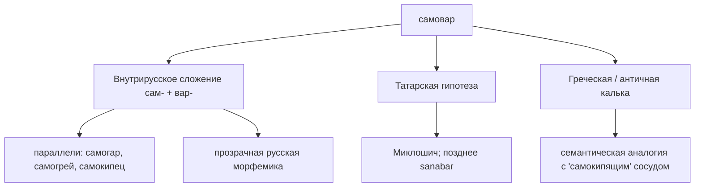
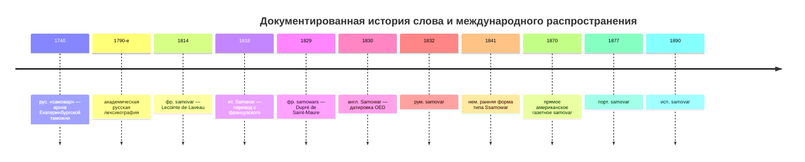

# «САМОВАР»: фундаментальное источниковедческое и лексикографическое исследование русского слова и его международных заимствований

Настоящее исследование выполнено по требованиям мастер-промпта проекта «Русский след», включая обязательное разграничение истории вещи и истории слова, самостоятельную проверку русского, американского английского, французского и восточноармянского материала, поиск иных заимствований, фиксацию научных противоречий и построение карты доказательств. fileciteturn0file0

**Резюме основных результатов.** Самое раннее найденное в ходе данного исследования прямое русское письменное свидетельство слова *самовар* относится не к концу XVIII века, а к февралю 1740 года: в документах Екатеринбургской таможни фигурирует «самовар медный», далее описанный как «самовар с прибором медный, луженый» и как изделие заводской работы. Государственный исторический музей также датирует наиболее раннее известное документальное упоминание 1740 годом. Это существенно: распространённые в иностранной исторической лексикографии датировки типа «рус. с 1789» отражают более поздний лексикографический/текстовый рубеж и не могут считаться terminus post quem существования слова. citeturn743620search0turn743620search2turn743620search3

Основное этимологическое объяснение — русское сложение основы *сам-* и элемента, связанного с *варить / вар*, то есть буквально конструкция типа «сам варит / самоварящий»; эту структуру поддерживают Шанский, Преображенский, французская и англоязычная лексикография. Однако уже Преображенский фиксировал альтернативу Миклошича — заимствование из татарского, одновременно выражая сомнение в её направлении; в современной популярной этимологии также встречается татарское *sanabar*. Доказательная база для тюркского источника заметно слабее внутреннерусского словообразовательного объяснения, особенно с учётом русских параллельных региональных образований *самогар, самогрей, самокипец*. citeturn709227search6turn828184search7turn632506search3

Во французском прямой русизм документируется особенно рано: работа Эвы Бюши на базе FEW, TLF и исторических словарей приводит фиксацию *samovar* уже в 1814 году у Lecointe de Laveau, затем *samowars* в 1829 году у Dupré de Saint-Maure и целый ряд XIX‑вековых вариантов. Бюши рассматривает французское слово именно как прямое заимствование из русского, а французский, в свою очередь, как вероятный или доказанный посредник для итальянского, испанского, португальского и, вероятно, каталонского. citeturn812518search6turn427535search7

В английском историческая лексикография датирует слово 1830 годом; академический обзор Бюши уточняет, что OED² фиксирует в этом году форму *Samowar*. Уже в американской прессе XIX века слово употребляется как обычное существительное: например, *New York Dispatch* 21 августа 1870 года пишет о «the “samovar,” or tea-urn». Это прямое американское свидетельство и оно не должно смешиваться с более ранней английской фиксацией вообще. citeturn306436search11turn425941search1

Для восточноармянского материала установлено принципиально важное расслоение: в научных армяноязычных работах реально зафиксированы и **սամովար**, и **սամավար**. Первая форма обсуждается как иностранное слово/экзотизм рядом с нормативным армянским эквивалентом **ինքնաեռ**; форма **սամավար** документирована в диалектологическом описании Вайоц Дзора как русское заимствование *(самовар) → ինքնաեռ*. Кроме того, исследование разговорной речи Еревана фиксирует форму **սամավառ**, то есть ещё один фонетико-графический вариант русизма в разговорном слое. Поэтому объединять *սամովար, սամավար, սամավառ* в одну литературную норму нельзя. citeturn321282search6turn321282search7turn321282search9

## Русский исходный материал: главы первая и вторая

**ГЛАВА 1. ПОЛНАЯ ХАРАКТЕРИСТИКА РУССКОГО СЛОВА**

Современная нормативная форма — **самова́р**, существительное мужского рода, неодушевлённое, второго склонения: *самова́р, самова́ра, самова́ру, самова́р, самова́ром, о самова́ре; самова́ры, самова́ров, самова́рам, самова́ры, самова́рами, о самова́рах*. Такое словоизменение согласуется с нормативной грамматикой и корпусно-лексикографическим описанием; Русский орфографический словарь на «Грамоте» использует систему нормативного ударения и грамматических помет, а открытые лексикографические данные для *самовар* дают тип склонения 1a по классификации Зализняка. citeturn709227search1turn696208search0

Основное современное значение — металлический сосуд/прибор с внутренним нагревательным устройством для кипячения воды, традиционно используемой прежде всего для чая. Большой толковый словарь русских существительных определяет его как металлическую ёмкость с ручками, краном и внутренней топкой-трубой; Даль — как «водогрейный, для чаю, сосуд», обычно медный, «с трубою и жаровнею внутри». Последнее определение важно исторически: оно описывает не любую чайную посуду, а особую конструкцию водонагревателя. citeturn709227search0turn828184search3

Семантическое ядро слова оказалось весьма устойчивым. В XIX веке и сегодня центральным остаётся значение водогрейного сосуда. Однако вокруг него возникли метонимические и культурно-прагматические употребления: *поставить самовар, пить чай из/у самовара, сидеть за самоваром*, где сосуд выступает центром чайного застолья; исторически это способствует метонимии «самовар → чаепитие / домашнее общение». Наличие подобных контекстов подтверждается литературной традицией: у Пушкина в «Гробовщике» (1830) работница «раздувает самовар», а у Чехова в «Спать хочется» (1888) маленький самовар приходится неоднократно подогревать. citeturn696208search0

Даль фиксирует гораздо более богатое историческое лексическое поле: *самоварец, самоварчик, самоваришка, самоварища; самоварник, самоварница*, а также региональные наименования того же предмета: ярославское/пошехонское **самогар**, вятское и курское **самогрей**, курское **самокипец**. В его же материале *самоварник / самоварница* может обозначать любителя чаепития, а *самоварницы* — чайных торговок на гуляньях. Это ценные свидетельства старой деривационной продуктивности и диалектной номинации. citeturn828184search3turn828184search17

Современные живые производные — **самова́рный**, **самова́рчик**; исторические образования значительно многочисленнее. «Грамота» нормативно фиксирует *самоварный* и *самоварчик*. citeturn738797search13turn738797search26

Фразеологически наиболее заметно выражение **ехать в Тулу со своим самоваром** — приносить/везти туда то, чего там и без того достаточно. Современная лексикография фиксирует его как разговорное, обычно с неодобрительным оттенком. citeturn828184search15

Региональное богатство названий нельзя трактовать как «варианты написания» слова *самовар*: *самогар, самогрей, самокипец* — самостоятельные лексемы, мотивированные сходной словообразовательной моделью. Именно наличие такого семейства является важным аргументом в пользу внутреннерусской мотивации названия. citeturn828184search3turn828184search7

**Корпусная частотность.** На текущей версии НКРЯ Основной корпус содержит свыше 426 млн слов. Публично индексируемая работа 2025 года приводит скриншот запроса по лемме *самовар* в более ранней по объёму версии корпуса: **661 пример в 521 тексте, IPM 1,7**. Эти цифры следует считать воспроизводимым снимком конкретной версии НКРЯ, а не вечной абсолютной частотой: корпус пополняется, поэтому пересчёт в интерфейсе 2026 года способен дать иные значения. citeturn709227search4turn696208search8

| Показатель | Зафиксированное значение | Методологический статус |
|---|---:|---|
| НКРЯ, объём корпуса на скриншоте исследования 2025 г. | 389 470 868 слов | исторический снимок |
| *самовар*: примеры | 661 | прямой результат интерфейса на момент снимка |
| Тексты | 521 | прямой результат |
| IPM | 1,7 на млн | нормированная частота |
| Современный объём Основного корпуса НКРЯ | 426 191 860 слов | текущий интерфейс, 2026 |

Историческое распределение качественно очевидно: слово широко представлено в художественных и бытовых текстах XIX–XX веков, от Пушкина и Чехова до позднейшей прозы. Однако точную диахронную серию по десятилетиям в этой сессии из интерфейса НКРЯ получить надёжно не удалось; поэтому я не подменяю её расчётом из Google Ngram или поисковых выдач. citeturn696208search0turn709227search4

**ГЛАВА 2. ЭТИМОЛОГИЯ И СЛОВООБРАЗОВАНИЕ**

Современный синхронный морфемный анализ: **сам-о-вар**: корень *сам-*, соединительный элемент *-о-*, корень *-вар-*. Этот анализ представлен, в частности, в словарных данных, восходящих к словообразовательному словарю Тихонова. citeturn696208search0

Историческое словообразовательное объяснение почти совпадает с прозрачной современной сегментацией. Шанский определяет слово как сложение основ **сам- + вар-**, последнюю связывает с *варить* ‘кипятить’; в качестве семантических параллелей приводит *самогар, самокипец, самогрей*. citeturn828184search7

Преображенский формулирует две близкие интерпретации внутренней формы: «сам даёт вар, то есть кипяток» либо, вероятнее, «сам варит (без печки)»; он сопоставляет *самовар* с типом *самострел, самолет, самокат*. Одновременно Преображенский сообщает, что Миклошич считал слово заимствованным из татарского, но замечает, что направление заимствования сомнительно. Он также упоминает гипотезу кальки древнего *authersa/authépsēs*, но сам не считает её реальным источником широко распространившегося русского названия. citeturn709227search6

Следовательно, доказательная иерархия выглядит так:

На сегодняшний день **внутрирусское образование является наиболее сильной рабочей гипотезой**, потому что оно одновременно объясняет форму, семантику и существование русской словообразовательной серии. Татарская гипотеза документирована в научной традиции и поэтому не может быть просто опущена, но прямого раннего татарского прототипа с надёжной хронологией, который предшествовал бы русскому свидетельству 1740 года и объяснял русскую форму лучше, в проведённом поиске не найдено. Это — оценочный вывод на основании источников, а не «доказательство отсутствия». citeturn709227search6turn828184search7turn743620search0

## История русского слова и английское заимствование: главы третья и четвёртая

**ГЛАВА 3. ИСТОРИЯ СЛОВА «САМОВАР»**

Ключевой результат исторического поиска — документ Екатеринбургской таможни февраля 1740 года. В опубликованной фотокопии архивного дела ГАСО, ф. 24, оп. 1, д. 903, читается упоминание «с самоваром медным с прибором»; связанная опись характеризует изделие как медное, лужёное и заводской работы. Н. Корепанов, сотрудник Института истории и археологии УрО РАН, указывает, что это первое известное ему употребление слова в документах горнозаводского Урала. citeturn743620search0turn743620search3

Это существенно меняет историко-лексикографическую картину. В международном исследовании русизмов Эва Бюши, опираясь на SSRLJ, приводит русскую датировку «с 1789». Но документ 1740 года — более раннее **первичное письменное свидетельство**; следовательно, 1789 следует понимать не как происхождение слова, а как датировку конкретного словарного/текстового источника, использованного предыдущей лексикографической традицией. citeturn306436search11turn743620search0

«Словарь Академии Российской» 1789–1794 годов включает *самовар* в общий алфавитный массив; указатель отсылает к статье на колонку 506. Таким образом, к концу XVIII века слово уже имело академический лексикографический статус. citeturn743620search7turn743620search8

В XIX веке слово прочно вошло в литературный русский: Пушкин употребляет его в «Гробовщике» 1830 года, а позднейшая художественная проза демонстрирует уже совершенно обычное бытовое функционирование. Даль во второй половине XIX века описывает целое гнездо производных и диалектных синонимов, что свидетельствует не о новом экзотизме, а о глубокой укоренённости лексемы. citeturn696208search0turn828184search3

Хронология:

Основания для этой схемы — русский архивный материал, исследование Бюши и американская газетная страница 1870 года. citeturn743620search0turn306436search11turn425941search1

**ГЛАВА 4. АМЕРИКАНСКИЙ АНГЛИЙСКИЙ**

Современная американская форма — **samovar**, существительное, исчисляемое; множественное **samovars**. American Heritage определяет его как металлическую урну с краном для кипячения воды к чаю, традиционно с дымоходом и угольным нагревом. Collins для американского английского даёт варианты произношения примерно /ˈsæməˌvɑr/ и /ˌsæməˈvɑr/, то есть допускает вариативное расположение главного/второстепенного ударения. citeturn632506search1turn632506search8

Графически английский закрепил почти прямую латинизацию рус. **самовар → samovar**. Ранняя форма **Samowar** отражает другую европейскую транслитерационную традицию, где русское *в* передавалось через *w*. Академическое исследование Бюши со ссылкой на OED² датирует английское *Samowar* 1830 годом и считает его прямым заимствованием из русского. citeturn306436search11

Семантического радикального переосмысления не произошло: основное значение остаётся ‘русский/восточноевропейский сосуд для нагревания воды для чая’. Однако американские словари обычно энциклопедизируют значение, добавляя признаки *metal urn, spigot, internal tube/chimney, Russia*. То есть в английском слово функционирует как культурно маркированное предметное название. citeturn632506search1turn632506search8

Морфологическое освоение полное для существительного: английское регулярное множественное **samovars**; специальной флексии или родовой категории нет. Collins прямо помечает слово как countable noun и даёт plural *samovars*. citeturn696208search7

Самая ранняя найденная в этой работе **прямая американская** фиксация — *New York Dispatch*, Нью‑Йорк, 21 августа 1870 года: в описании русского крестьянского быта говорится о «the “samovar,” or tea-urn». Это показывает, что американскому читателю слово ещё снабжали английской глоссой, то есть оно было узнаваемым, но не предполагалось полностью прозрачным. citeturn425941search1

В 1887 году американская газетная статья о России уже пишет, что медные урны по всей империи «are called samovars», а автору оказалось важно включить слово *samovar* в свой «Russian vocabulary». Это яркое свидетельство канала распространения через путешествия и этнографическое описание России. citeturn425941search15

К концу XIX века слово регулярно появляется в американских книгах о России: издание 1898 года *Roundabout Rambles in Northern Europe* многократно употребляет *samovar* без перевода или лишь с контекстным описанием. citeturn425941search2

Различие британской и американской истории принципиально. Датировка 1830 в OED относится к английскому языку вообще и не является доказательством американского употребления в США. Для США надёжно подтверждённая данным поиском газетная фиксация начинается не позднее 1870 года. citeturn306436search11turn425941search1

По современной частоте слово редкое. Wordfreq‑агрегатор оценивает его примерно как одно употребление на 13 млн слов письменного английского, но это не специализированный американский исторический корпус, поэтому показатель годится лишь как ориентир современного распространения. Точный COHA/COCA-счёт в открытом интерфейсе в этой сессии не был надёжно извлечён и потому не подменяется догадкой. citeturn696208search6

## Французский и восточноармянский: главы пятая и шестая

**ГЛАВА 5. ФРАНЦУЗСКИЙ ЯЗЫК**

Современное французское **samovar** — существительное мужского рода, множественное **samovars**. Larousse определяет его как «сорт чайника/кипятильника с краном», используемого в России и на Ближнем Востоке для нагревания воды для чая; Академия Французская в 8‑м издании (1935) даёт краткое определение металлического сосуда с горячей водой для приготовления чая. citeturn961401search0turn961401search1

TLF даёт произношение **/samɔvaʀ/**, множественное *samovars* и историческую линию: *samowars* в 1829 году у Dupré de Saint‑Maure, *samovar* в 1843 году у Xavier Marmier. В литературной базе TLF абсолютная частота указана как 17; это частота внутри словарного корпуса TLF, а не общая частота современного французского. citeturn306436search3

Более глубокая проверка показывает, что 1829 год не является самым ранним французским свидетельством. Бюши приводит **1814**: *samovar* у Georges Lecointe de Laveau, *Moscou avant et après l'incendie*, p. 72. Само издание 1814 года подтверждено библиографически как первое издание труда очевидца, позднее переизданного в 1818 году. citeturn812518search6turn427535search4

Для XIX века обнаружен следующий набор графических вариантов: **samovar, samowar(s), samovare, somovar, samavar, samawar**, а в одном источнике OCR/печатный вариант типа *samayars*. Они не равноправны в современной норме: закрепилось *samovar*. Бюши объясняет часть колебаний влиянием русской безударной вокализации и нестабильной ранней транслитерации. citeturn812518search6

Французское слово морфологически интегрировано: мужской род, обычный французский plural *-s*. Фонетически русское конечное ударение не воспроизводится как фонологическое словесное ударение русского типа, поскольку французская просодия организована иначе; сегментно форма адаптирована как /sa.mɔ.vaʀ/. citeturn306436search3

Семантика в основном сохранилась, но французские определения исторически усиливают этнографическую характеристику — «bouilloire à thé russe». Именно путешествия французов в Россию являются вероятнейшим ранним каналом проникновения: первые фиксации находятся в описаниях Москвы и России, составленных французскими путешественниками/наблюдателями. Бюши прямо использует характер ранних свидетельств как аргумент за **прямое русское происхождение**, а не за посредника. citeturn812518search6turn427535search1

Особенно важно международное посредничество французского. Академический анализ Бюши документирует:
- итальянское **Samavar** с 1818 года в тексте, переведённом с французского;
- португальское **samovar** с 1877 года через французский;
- испанское **samovar** с 1890 года через французский;
- каталонское *samovar* XX века, вероятно также через французский. citeturn812518search6

Treccani независимо подтверждает для итальянского *samovàr* происхождение «dal russo ... attraverso il francese», то есть через французский. Это важное независимое подтверждение роли французского как языка-посредника. citeturn306436search2

**ГЛАВА 6. ВОСТОЧНОАРМЯНСКИЙ ЯЗЫК**

Армянский материал требует особенно строгой стратификации. В доступных армяноязычных научных источниках найдены как минимум три формы, связанные с рус. *самовар*: **սամովար**, **սամավար**, **սամավառ**. Их нельзя объявлять взаимозаменяемыми литературными вариантами. citeturn321282search6turn321282search7turn321282search9

Форма **սամովար** непосредственно обсуждается в научной публикации Института языка НАН Армении в противопоставлении **սամովար — ինքնաեռ**. Автор рассматривает ситуацию, когда русизм имеет армянский эквивалент: употребление *սամովար* в соответствующей среде может выполнять функцию мотивированного иноязычного/экзотизирующего элемента. Это очень важное свидетельство: наличие слова в армянском тексте ещё не означает, что оно является нейтральной нормативной лексемой вместо **ինքնաեռ**. citeturn321282search6

В академическом труде по заимствованиям приводится **սամովար «ինքնաեռ»** рядом с *թեյնիկ* и *բորշչ* как пример заимствованной лексики; следовательно, форма признаётся как русизм армянской речи/лексики, хотя её стилистический статус может зависеть от контекста. citeturn321282search8

Форма **սամավար** прямо зафиксирована в диалектологическом описании Вайоц Дзора в перечне русских заимствований: **սամավար (самовар) — ինքնաեռ**. Это прямое доказательство реальности формы *սամավար* в региональном материале и одновременно свидетельство её связи с русским источником. citeturn321282search7

Исследование ереванской разговорной речи фиксирует также **սամավառ** с переводом **ինքնաեռ**. Конечная буква **ռ** здесь отражает иной способ фонетико-графической передачи русского /r/ в разговорной адаптации. Эта форма особенно ценна как подтверждение того, что русизм функционировал не только как книжное цитирование, но и в разговорном слое. citeturn321282search9

Таким образом:

| Форма | Тип доказательства | Статус, который можно утверждать |
|---|---|---|
| **ինքնաեռ** | армянский нормативный эквивалент | собственно армянское обозначение ‘самовар’ |
| **սամովար** | научные статьи, обсуждение русизмов/экзотизмов | документированный русизм |
| **սամավար** | диалектологическая монография, Вайоц Дзор | документированная региональная адаптация |
| **սամավառ** | исследование разговорной речи Еревана | документированная разговорная форма |

Графическая адаптация **самовар → սամովար** близка к фонемной транслитерации: с-а-м-о-в-а-р → ս-ամ-ո-վ-ա-ր. В **սամավար** второй безударный русский *о* передан как *ա*; это может соответствовать восприятию русского аканья, но для конкретного диалектного случая такое объяснение следует считать аналитическим выводом, а не прямой формулировкой источника. Форма **սամավառ** дополнительно меняет конечную ротическую согласную. citeturn321282search7turn321282search9

Морфологическая интеграция очевидна уже из самой возможности включать формы в армянский синтаксис и словарные перечни, однако надёжной академической парадигмы склонения именно *սամովար* в найденных словарных источниках получить не удалось. Поэтому формы родительного, множественного и определённого артикля здесь не реконструируются искусственно. Это один из нерешённых пунктов исследования. citeturn410959search1turn321282search6

## Другие языки и сопоставительная типология: главы седьмая и восьмая

**ГЛАВА 7. ДРУГИЕ ЯЗЫКИ**

Наиболее надёжно документированные в найденных академических источниках международные соответствия следующие. citeturn812518search6turn306436search0turn306436search2

| Язык | Форма | Ранняя датировка / источник | Путь |
|---|---|---:|---|
| Французский | *samovar* | 1814 | прямое из русского |
| Итальянский | *Samavar* | 1818 | через французский |
| Английский | *Samowar* | 1830 | прямое из русского |
| Румынский | *samovar* | 1832 | прямое из русского |
| Немецкий | ранн. форма типа *Ssamowar*, совр. *Samowar* | 1841 | из русского |
| Португальский | *samovar* | 1877 | через французский |
| Испанский | *samovar* | 1890 | через французский |
| Каталанский | *samovar* | с 1932 | вероятно через французский |
| Турецкий | *semaver* | современно документировано | русский источник широко принимается, точная ранняя датировка требует отдельного архивного поиска |

Для немецкого Duden фиксирует **der Samowar**, Genitiv *des Samowars*, Plural **die Samoware**, значение ‘русская чайная машина’ и происхождение от русского *samovar*. Здесь степень морфологической интеграции высока: слово получает немецкий мужской род и собственный продуктивный plural *-e*. citeturn306436search0

Для итальянского Treccani фиксирует **samovàr**, мужской род и русский источник **через французский**. Это один из лучших примеров многоступенчатого заимствования: русский → французский → итальянский. citeturn306436search2

Для румынского Бюши фиксирует *samovar* с 1832 года и варианты *samavar, samuvar*; автор связывает вариант *samavar* с восприятием русского безударного /o/ как [a]-подобного звука. citeturn812518search6

Для турецкого современная форма **semaver / semâver** надёжно засвидетельствована словарными ресурсами; однако в рамках нынешнего поиска не найден авторитетный первичный исторический источник, позволяющий уверенно назвать первую дату и полностью исключить посредничество кавказских/балканских языков. Поэтому турецкий включён как документированное соответствие, но его ранняя контактная история оставлена открытой. citeturn410959search3

**ГЛАВА 8. СРАВНИТЕЛЬНЫЙ АНАЛИЗ**

| Параметр | Русский | Американский английский | Французский | Восточноармянский |
|---|---|---|---|---|
| Базовая форма | самова́р | samovar | samovar | սամովար / регион. սամավար, разг. սամավառ |
| Письмо | кириллица | латиница | латиница | армянское |
| Источник | внутреннее образование, наиболее вероятно | русский | русский | русский |
| Ранняя фиксация | 1740 | не позднее 1870 в США; англ. вообще 1830 | 1814 | точная первая дата не установлена |
| Род | м. | нет категории рода | м. | зависит от армянской грамматики; специальный род отсутствует |
| Мн. число | самовары | samovars | samovars | точная нормативная парадигма не установлена |
| Ударение | финальное /-ˈvar/ | вариативное | французская фразовая просодия | требует отдельного фонетического источника |
| Семантика | водогрейный сосуд + культурные метонимии | русский чайный водонагреватель | bouilloire russe / à thé | русизм рядом с ինքնաեռ |
| Степень освоения | исходная лексема | полное морфологическое, культурно маркированное | полное морфологическое | неодинакова по вариантам и регистрам |

Графически английский и французский закрепили форму, почти изоморфную международной транслитерации **samovar**, тогда как немецкий сохраняет **w** в **Samowar**, отражая германскую орфографическую традицию передачи /v/. Армянский использует собственное письмо и допускает несколько фонетически ориентированных способов передачи русских безударных гласных и ротических. citeturn306436search0turn812518search6turn321282search7

Фонетически русское [səmɐˈvar] содержит редукцию двух предударных гласных и конечное ударение; английский адаптирует гласные под свою систему и допускает несколько акцентных моделей; французский TLF даёт /samɔvaʀ/. Следовательно, одинаковая латинская графика *samovar* маскирует реальные фонетические различия. citeturn696208search0turn632506search8turn306436search3

Семантически английский и французский демонстрируют **сохранение с культурным сужением**: слово обозначает прежде всего типичный русский/евразийский чайный прибор. Русский имеет более широкий исторический культурный ассоциативный фон и производное гнездо. В армянском наличие собственного **ինքնաեռ** создаёт конкуренцию, поэтому русизм может получать стилистическую или региональную маркированность. citeturn632506search1turn961401search0turn321282search6

По степени интеграции наиболее «обычно словарными» заимствования выглядят во французском, английском, немецком и итальянском: они имеют закреплённую орфографию и обычные грамматические модели принимающего языка. Восточноармянский материал существенно менее однороден: там фиксируется конкуренция литературного собственного эквивалента и нескольких русифицированных форм. citeturn306436search0turn306436search2turn321282search6turn321282search7

## Историко-культурная передача и научные споры: главы девятая и десятая

**ГЛАВА 9. ИСТОРИКО-КУЛЬТУРНЫЙ КОНТЕКСТ**

История слова тесно связана с распространением представлений о русском чаепитии, но эти процессы нельзя отождествлять. Русское слово документировано в 1740 году независимо от того, когда возникла сама конструкция водонагревателя. Уже в XIX веке иностранные путешественники описывали самовар как характерный бытовой объект, и именно travel writing стал одним из основных каналов лексического экспорта. citeturn743620search0turn427535search1turn425941search15

Во Франции ранние свидетельства происходят из текстов о Москве и российском быте; в английском — из книг и газет о России. Американская газета 1870 года ещё поясняет *samovar* через *tea-urn*, а к концу века американские книжные тексты уже употребляют слово свободнее. Это классическая траектория экзотизма: сначала иноязычный термин плюс пояснение, затем самостоятельное употребление. citeturn425941search1turn425941search2

Материальная культура усилила узнаваемость слова. Библиотека Конгресса хранит американские изображения русского быта с самоваром и изображения бытовых электроприборов начала XX века, где *samovar* уже выступает как тип бытового устройства, а не исключительно текстовый русизм. citeturn425941search3turn425941search6

Французское международное культурное посредничество особенно заметно: слово пришло во французский напрямую из русского, а затем из французского распространилось в часть романских языков. Таким образом, «русский след» может быть прямым этимологически, но опосредованным контактно-исторически. citeturn812518search6turn306436search2

**ГЛАВА 10. НАУЧНЫЕ ПРОТИВОРЕЧИЯ**

Главное этимологическое противоречие — **внутрирусское сложение против татарского источника**. Преображенский приводит обе позиции, но считает русское объяснение более вероятным; Шанский прямо анализирует слово как *сам- + вар-*. Популярный англоязычный Etymonline сохраняет оговорку, что прозрачная русская этимология теоретически может быть народно-этимологической, если исходным было татарское *sanabar*. Прямой древний татарский источник, хронологически предшествующий 1740 году и надёжно документированный в настоящем поиске, не найден. citeturn709227search6turn828184search7turn632506search3

Второй спор — **первая датировка русского слова**. Международная историческая лексикография иногда приводит 1789; архивный документ фиксирует 1740. Эти даты не обязательно «противоречат» одна другой, если 1789 — дата первого свидетельства внутри конкретной словарной базы, а не абсолютная первая письменная фиксация. Но использовать 1789 как «дату возникновения слова» после публикации документа 1740 года нельзя. citeturn306436search11turn743620search0

Третий спор — **первое французское свидетельство**. TLFi начинает исторический ряд с 1829 *samowars*, однако более специализированное исследование Бюши, использующее дополнительные материалы, приводит *samovar* 1814 года. Следовательно, 1814 является более ранним найденным свидетельством, а 1829 — ранней фиксацией в базе TLF/DDL. citeturn306436search3turn812518search6

Четвёртая проблема — **американская против английской датировки**. 1830 — английская дата OED, но не доказательство употребления в США. Для американского английского прямое газетное свидетельство, найденное здесь, датируется 1870 годом. citeturn306436search11turn425941search1

Пятая проблема — **армянский статус**. Наличие *սամովար* в армянской речи не позволяет автоматически назвать его нейтральной литературной нормой, поскольку научный источник прямо противопоставляет ему собственный эквивалент *ինքնաեռ* и обсуждает русскую форму как стилистически мотивированное чужое слово. Одновременно *սամավար* и *սամավառ* подтверждены как региональные/разговорные формы. citeturn321282search6turn321282search7turn321282search9

## Карта доказательств и полный реестр: главы одиннадцатая и двенадцатая

**ГЛАВА 11. КАРТА ДОКАЗАТЕЛЬСТВ**

| Утверждение | Категория | Источник | Доказательство / ограничение |
|---|---|---|---|
| Рус. *самовар* документирован в 1740 | **Прямое подтверждение** | [S1], [S2] | архивная запись и её публикация |
| Слово существовало раньше словарной датировки 1789 | **Обоснованный вывод** | [S1]+[S12] | 1740 < 1789 |
| Наиболее вероятно рус. *сам- + вар-* | **Обоснованный вывод** | [S3], [S4] | прозрачная структура + параллели |
| Татарская этимология существует | **Прямое подтверждение научной позиции** | [S3] | Преображенский сообщает мнение Миклошича |
| Татарская этимология доказана | **Не установлено** | — | достаточного раннего первичного материала не найдено |
| Франц. *samovar* засвидетельствовано в 1814 | **Прямое подтверждение через историко-лексикографическое исследование** | [S13] | Laveau, p. 72 |
| Французский — прямой русизм | **Обоснованный научный вывод** | [S13] | ранние французские travelogues |
| Французский передал слово итальянскому | **Прямо аргументировано** | [S13], [S16] | ранняя итальянская фиксация в переводе с французского |
| Англ. *Samowar* известен с 1830 | **Прямое словарное подтверждение** | [S13] | OED² в академическом обзоре |
| США: *samovar* документирован в 1870 | **Прямое подтверждение** | [S18] | New York Dispatch |
| Арм. *սամովար* реально употребляется | **Прямое подтверждение** | [S21], [S22] | армяноязычные научные публикации |
| Арм. *սամավար* реально существует | **Прямое подтверждение** | [S23] | Вайоц Дзор, диалектология |
| *սամավար* — общеармянская литературная норма | **Не установлено** | — | найден только региональный источник |
| Арм. *սամավառ* существует в разговорной речи | **Прямое подтверждение** | [S24] | корпус/описание ереванской разговорной речи |
| Русское слово активно в НКРЯ | **Прямое подтверждение** | [S8] | 661 пример, IPM 1,7 на снимке корпуса |

**ГЛАВА 12. ПОЛНЫЙ РЕЕСТР ОСНОВНЫХ ИСТОЧНИКОВ**

[S1] Государственный архив Свердловской области, ф. 24, оп. 1, д. 903; фотокопия и расшифровка документа 1740 года опубликованы проектом «Ураловед». citeturn743620search0

[S2] Корепанов Н. «Уральский самовар. Не он ли был первым в России?»; публикация материала архивного документа 1740 года и исторический комментарий. citeturn743620search3

[S3] Преображенский А. Г. *Этимологический словарь русского языка*, статья **самоваръ**: внутреннерусское толкование, татарская гипотеза Миклошича, гипотеза античной кальки. Электронная копия на ресурсе Института русского языка РАН. citeturn709227search6

[S4] Шанский Н. М. *Этимологический словарь русского языка*, статья **самовар**: сложение *сам-* и *вар-*; параллели *самогар, самокипец, самогрей*. citeturn828184search7

[S5] Даль В. И. *Толковый словарь живого великорусского языка*, 2-е изд., 1882, статья **самовар**: определение, производные и диалектные наименования. citeturn828184search3

[S6] «Грамота.ру», Большой толковый словарь русских существительных, **самовар**; современное определение. citeturn709227search0

[S7] Русский орфографический словарь / Грамота.ру, ред. В. В. Лопатин, О. Е. Иванова, 6-е изд., 2023; нормативные принципы написания, ударения и грамматических помет. citeturn709227search1

[S8] Национальный корпус русского языка; современный объём Основного корпуса и опубликованный снимок запроса по *самовар* — 661 пример, 521 текст, IPM 1,7. citeturn709227search4turn696208search8

[S9] *Словарь Академии Российской*, 1789–1794; электронный каталог Президентской библиотеки и академический индекс. citeturn743620search1turn743620search7

[S10] American Heritage Dictionary, **samovar**: американское определение и происхождение из русского. citeturn632506search1

[S11] Collins English Dictionary / Webster's New World, **samovar in American English**: американское произношение и значение. citeturn632506search8

[S12] Merriam-Webster tradition: датировка 1830; важно учитывать, что First Known Use обозначает раннейшее найденное письменное свидетельство, а не момент возникновения слова. citeturn632506search0turn632506search11

[S13] Buchi, Éva. Исследование русизмов и их диатопического распространения; статья/таблица **samovar**: рус., франц., англ., итал., рум., исп., порт., кат. формы и датировки; ATILF/CNRS. citeturn812518search6

[S14] Académie française, 8e éd., 1935, **samovar**. citeturn961401search1

[S15] Larousse, **samovar**. citeturn961401search0

[S16] Treccani, **samovàr**: итальянское слово из русского через французский. citeturn306436search2

[S17] TLFi / CNRTL, **samovar**: произношение /samɔvaʀ/, исторические формы и литературная частота; текст статьи доступен через зеркальный индекс и подтверждается инфраструктурой ATILF. citeturn306436search3turn812518search2

[S18] *New York Dispatch*, 21 August 1870, p. 6, Library of Congress: “the ‘samovar,’ or tea-urn”. citeturn425941search1

[S19] Американская газета 1887 года, оцифрованная Library of Congress: *samovars* в описании России. citeturn425941search15

[S20] *Roundabout Rambles in Northern Europe*, 1898, Library of Congress: неоднократное английское *samovar* в американском издании о России. citeturn425941search2

[S21] Институт языка им. Р. Ачаряна НАН Армении, сборник молодых лингвистов: **սամովար — ինքնաեռ**, обсуждение экзотизма/иноязычия. citeturn321282search6

[S22] Армяноязычная теоретическая работа о заимствованиях: *սամովար «ինքնաեռ»* как пример заимствованной лексики. citeturn321282search8

[S23] Диалектологическая монография по Вайоц Дзору: **սամավար (самовар) — ինքնաեռ** среди русских заимствований. citeturn321282search7

[S24] Исследование ереванской разговорной речи: **սամավառ — ինքնաեռ**. citeturn321282search9

[S25] Duden, **Samowar**: мужской род, Gen. *Samowars*, Pl. *Samoware*, русское происхождение. citeturn306436search0

## Нерешённые вопросы и дополнительные находки: главы тринадцатая и четырнадцатая

**ГЛАВА 13. НЕРЕШЁННЫЕ ВОПРОСЫ**

Первое — требуется отдельная архивно-корпусная проверка, существует ли русское свидетельство **раньше февраля 1740 года**. 1740 — самое раннее найденное и опубликованное в рамках настоящего исследования, но строго научная формулировка должна быть «самое раннее найденное свидетельство», а не «дата возникновения слова». citeturn743620search0turn743620search3

Второе — татарская гипотеза нуждается в проверке по историческим татарским словарям и рукописным корпусам XVIII века. Пока научно корректно говорить, что гипотеза известна, но её приоритет перед прозрачным русским образованием **не доказан найденным материалом**. citeturn709227search6turn632506search3

Третье — для американского английского возможны свидетельства **раньше 1870 года** в американской печати. 1870 — раннейшая прямая американская газетная фиксация, найденная в данном поиске, но не окончательный terminus ante quem для США. citeturn425941search1

Четвёртое — для французского желательно отдельно просмотреть факсимиле страницы 72 издания Lecointe de Laveau 1814 года и страницы Dupré de Saint-Maure 1829 года, чтобы зафиксировать точное окружение ранних форм и пунктуацию. Библиографическая и лексикографическая аттестация 1814/1829 надёжна, но полный контекст первичного оттиска в текущем веб-доступе извлечён не полностью. citeturn812518search6turn427535search0turn427535search4

Пятое — в восточноармянском остаётся неопределённой полная нормативная парадигма **սամովար** и точная хронология первого употребления. Нужен постраничный поиск по словарям Агаяна 1976 года, четырёхтомному *Ժամանակակից հայոց լեզվի բացատրական բառարան* и полнотекстовым армянским корпусам. Доступные армянские ресурсы подтверждают существование этих словарей, но поисковая выдача в данной сессии не дала надёжной словарной карточки *սամովար*. citeturn410959search1turn321282search0

Шестое — формы **սամովար, սամավար, սամավառ** требуют отдельного фонетического полевого анализа: графика ясно различается, но без аудио/фонетической транскрипции конкретных носителей нельзя автоматически переносить произношение из написания. citeturn321282search7turn321282search9

**ГЛАВА 14. ДОПОЛНИТЕЛЬНЫЕ ИССЛЕДОВАТЕЛЬСКИЕ НАХОДКИ**

Особенно значимая находка — французский язык выступает не просто одним из языков‑реципиентов, а **вторичным центром распространения русизма**. На материале *samovar* хорошо видна цепочка «русский → французский → часть романских языков». Это делает слово показательным кейсом для теории многоступенчатого заимствования. citeturn812518search6turn306436search2

Второй важный вывод — форма заимствования иногда кодирует **не русскую орфографию, а русское произношение**. Румынское *samavar* и восточноармянское *սամավար* хорошо согласуются с восприятием безударного русского /o/ как [a]-подобного. Для румынского Бюши прямо предлагает такое объяснение; для армянского это лишь сопоставительный аналитический вывод, требующий отдельного фонетического подтверждения. citeturn812518search6turn321282search7

Третий вывод касается степени освоения: формальная морфологическая интеграция не тождественна культурной нейтрализации. Английское и французское слово грамматически полностью встроено в системы этих языков, но сохраняет сильную русскую культурную маркировку. Армянский случай ещё сложнее: русизм сосуществует с собственным **ինքնաեռ**, поэтому степень интеграции зависит от регистра и региона. citeturn632506search1turn961401search0turn321282search6

Наконец, слово *самовар* оказывается исключительно удачным объектом для проекта «Русский след»: его русская письменная история документируется по крайней мере с 1740 года, международное распространение прослеживается с начала XIX века, а разные языки демонстрируют почти все основные механизмы освоения заимствования — прямую транслитерацию, раннюю вариантность, фонетически мотивированное изменение гласных, присвоение грамматического рода, регулярное множественное число, опосредованное распространение через французский и конкуренцию с собственным национальным эквивалентом. citeturn743620search0turn812518search6turn306436search0turn321282search6