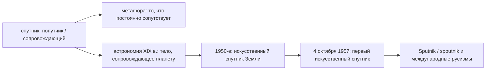

# «Русский след»: фундаментальное источниковедческое исследование слова «спутник»

## Резюме исследования и источниковая рамка

Исследовательское задание требует строго разграничивать четыре явления: древнее/докосмическое русское нарицательное **спутник**, астрономическое значение «небесное тело, обращающееся вокруг другого», термин **искусственный спутник**, существовавший до октября 1957 года, и международное употребление **Sputnik / Spoutnik / Սպուտնիկ** после советского запуска. Это разграничение принципиально: всемирная известность октября 1957 года не является датой возникновения русского слова и сама по себе не доказывает превращение имени аппарата в полноценное лексическое заимствование в каждом принимающем языке. Именно такая методика задана в исходном исследовательском брифе проекта. fileciteturn0file0

Главный результат исследования состоит в следующем. Русское **спу́тник** достоверно существовало задолго до космической эры как обозначение попутчика, сопровождающего лица и метафорически сопутствующего явления; не позднее XIX века оно уже было обычным русским астрономическим термином для естественного спутника планеты. Словарь Даля прямо определяет спутник как «луну, меньшее небесное тело», приводя Юпитер и Сатурн; русская астрономическая литература 1876 года систематически говорит о «спутниках Юпитера», а энциклопедическая литература около 1900 года имеет самостоятельную статью **Спутники**. Следовательно, семантический переход «сопровождающий человек → сопровождающий небесный объект» совершился в русском языке значительно раньше 1957 года. [S2–S5] citeturn678355search0turn983378search7turn983378search6

Ещё важнее для истории космического значения: сочетание **искусственный спутник Земли** достоверно существовало до запуска. Советская печать 7 августа 1955 года объясняла читателю, «что такое искусственный спутник», а государственные документы 5–8 августа 1955 года употребляли это словосочетание при обсуждении будущего аппарата. В 1957 году, ещё до 4 октября, Ю. А. Победоносцев выпустил отдельную брошюру *Искусственный спутник Земли*. Таким образом, значение «искусственный объект на орбите» возникло не как послезапусковое переосмысление собственного имени **Спутник**, а как развитие уже существовавшего русского астрономического термина. [S6–S8] citeturn678355search10turn678355search6turn983378search3

При этом советские первичные документы октября 1957 года создают важную ономастическую проблему. Сообщение ТАСС говорит не о заранее данном собственном имени «Спутник-1», а о **первом искусственном спутнике Земли**, **первом спутнике**, **спутнике**. Архивный проект РГАНТД называет аппарат ПС/ПС‑1; историческое исследование NASA также отмечает, что советская пресса обычно называла его просто *Sputnik*, русским словом «satellite». Поэтому привычное сегодня **«Спутник‑1» / Sputnik 1** следует отличать от первоначального русского способа именования в документах 4–5 октября 1957 года: значительная часть статусной «собственноименности» была закреплена международной рецепцией и последующей номенклатурой. [S9–S11] citeturn762528search0turn762528search2turn762528search5

Международная судьба слова неодинакова. В американском английском **Sputnik/sputnik** быстро стало словарно закреплённым русизмом, прежде всего как название или обозначение советских спутников; во французском нормативной адаптацией стала форма **spoutnik**, причём CNRTL датирует вариант *spoutnic* 1957 годом и *spoutnik* 1960 годом. Немецкий **Sputnik** и итальянский **sputnik/Sputnik** также словарно зафиксированы как русизмы, но их семантическая интеграция не тождественна: немецкий Duden ограничивает значение первыми советскими искусственными спутниками, а Treccani фиксирует историческое расширение до нарицательного обозначения последующих советских искусственных спутников. [S12–S19] citeturn140449search1turn140449search3turn961573view0turn636335search2turn519469search0turn519469search1

Для восточноармянского данные существенно слабее. Форма **սպուտնիկ** реально существует в современной армянской языковой среде и описывается вторичным лексикографическим источником как разговорное заимствование из русского со значениями «спутник» и «спутниковое телевидение», однако в доступном поиске не удалось получить непосредственно скан статьи **սպուտնիկ** из академического толкового словаря. Академическая инфраструктура НАН Армении подтверждает наличие необходимых словарей — *Ժամանակակից հայոց լեզվի բացատրական բառարան* 1969–1980, словарь Агаяна 1976 года, этимологический словарь Джаукяна 2010 года и русско-армянские словари, — но отсутствие доступной конкретной статьи не позволяет приравнять разговорное **սպուտնիկ** к бесспорно нормативному общеармянскому термину. [S20–S23] citeturn409164search1turn488894search5turn409164search0turn488894search1

## Русское слово: норма, значения и история до космической эры

Современная нормативная форма — **спу́тник**. «Большой орфоэпический словарь русского языка» на «Грамоте» даёт формы **спу́тника, мн. спу́тники, спу́тникам** и произносительную характеристику со смягчённым [т’] перед *н*. Это существительное мужского рода; морфологическая одушевлённость зависит от значения: при обозначении человека винительный падеж множественного числа совпадает с родительным (*вижу спутников*), тогда как при обозначении космических объектов слово функционирует как неодушевлённое. Последнее — грамматическое следствие семантического расщепления лексемы, а не существование двух разных этимологических слов. [S2] citeturn657561search1

Семантическое ядро исторически строится вокруг идеи **совместного движения или сопутствия**. Ушаков в словаре 1935–1940 годов, то есть за два десятилетия до космического запуска, различает четыре значения: человека-попутчика; того, кто сопровождает человека в жизни; переносно — явление, которое чему-либо сопутствует; и астрономически — небесное тело, обращающееся вокруг планеты. В качестве примеров приводятся «Луна — спутник Земли» и «Спутники Юпитера». Там же засвидетельствовано ещё одно культурное употребление — название справочников, журналов и руководств, например *Спутник агитатора*. [S3] citeturn678355search2

Даль фиксирует ещё более широкое докосмическое словообразовательное гнездо: **сопутный, сопутье, сопутничать, сопутствовать, сопутник, спутник, спутница, спутничество**. Его определение астрономического значения предельно ясно: спутник — «луна, меньшее небесное тело», которое движется вокруг планеты; в качестве иллюстрации названы несколько спутников Юпитера и Сатурна. Даль одновременно приводит метафорическое **ненастье — спутник юго-западных ветров**. Поэтому уже лексикография XIX века демонстрирует три самостоятельных семантических ветви: человек, сопутствующее явление и небесное тело. [S4] citeturn678355search0turn678355search1

Астрономическое употребление не было случайной словарной инновацией. Русский перевод астрономии Н. Локьера 1876 года многократно употребляет термин **спутник** в техническом описании прохождений, затмений и покрытий спутников Юпитера. Энциклопедический словарь Брокгауза и Ефрона около 1900 года имеет отдельную статью **«Спутники»**, определяя их как тела Солнечной системы, обращающиеся около планеты и вместе с нею вокруг Солнца. Значит, к последней четверти XIX века это уже устойчивый русский специальный термин, а не поздняя калька эпохи ракетной техники. [S5] citeturn983378search7turn983378search6

Докосмический статус подтверждает и лексикография XX века. Ушаков не маркирует астрономическое значение как новое; оно включено в словарь 1930-х годов рядом с традиционным значением попутчика. Лингвострановедческий словарь Института Пушкина также отмечает, что до середины XX века слово было распространено в человеческом и переносном значениях, тогда как астрономическое употребление существовало главным образом в профессиональной сфере. [S3, S24] citeturn678355search2turn678355search9

В 1955 году происходит следующий документируемый семантический этап: прилагательное **искусственный** присоединяется к уже существующему астрономическому существительному. Газета от 7 августа 1955 года не объясняет само слово *спутник* как неологизм, а объясняет техническую конструкцию *искусственный спутник*: ракета, достигшая необходимой скорости, «станет спутником нашей планеты и подобно Луне» будет обращаться вокруг неё. Государственная записка Королёва, Хруничева и Рябикова от 5 августа и постановление от 8 августа употребляют формулу **создание искусственного спутника Земли** как уже понятный термин. [S6, S7] citeturn678355search10turn678355search6

Это позволяет реконструировать семантическую цепочку без предположения о заимствовании астрономического значения из какого-либо одного иностранного языка:

Схема отражает документированную последовательность: человеческое и переносное значения засвидетельствованы традиционной лексикографией, естественные спутники — не позднее XIX века, «искусственный спутник» — до запуска, а международное распространение русской формы — после запуска 4 октября 1957 года. [S3–S10] citeturn678355search0turn983378search7turn678355search10turn762528search0

Точная **первая в истории письменная фиксация** слова в значении попутчика и точная первая фиксация астрономического значения в настоящем поиске не установлены. Даль и астрономическая книга 1876 года задают надёжный верхний хронологический предел, но не доказывают, что более ранних употреблений не существовало. Поэтому формулировка «астрономическое значение появилось в XIX веке» была бы чрезмерно сильной; корректно: **оно достоверно существовало не позднее XIX века**. [S4, S5] citeturn678355search0turn983378search7

Частотность также требует осторожности. Национальный корпус русского языка предоставляет огромные панхронические и специализированные подкорпуса, включая астрономическую тематику, но в доступной выдаче этого исследования не удалось получить воспроизводимую лемматизированную частоту именно **спутник** с разбивкой по значениям. Поэтому никакой условный балл типа «8/10» здесь не присваивается. [S25] citeturn657561search7

## Этимология и словообразовательная структура

Синхронно русское **спутник** воспринимается как член словообразовательного ряда *путь — путник — спутник*, однако исторический анализ требует не механически «нарезать» современную форму, а учитывать древние славянские образования с компонентом совместности. Международные этимологические словари, объясняя заимствованный английский *sputnik*, сходятся на разложении русской основы как **s-/со- «вместе, с» + put’ «путь» + -nik**, то есть буквально «тот, кто находится с кем-либо в пути». American Heritage непосредственно связывает слово с русским *sputnik (zemli)* и компонентами *s-/so-* + *put’* + *-nik*; CNRTL даёт для французского русизма то же объяснение: русский префикс *s-* соответствует французскому *avec*, а *-nik* — суффикс существительного деятеля. [S14, S16] citeturn140449search3turn961573view0

Исторически важно, что **-ник** не является «космическим» суффиксом и не возник в 1957 году. Английская этимологическая традиция указывает на славянскую агентную функцию, а история американского английского показывает существование образований на *-nik* через идиш и раньше Sputnik. Поэтому популярное представление, будто именно запуск первого спутника «создал» суффикс *-nik* в английском, неверно; событие лишь резко усилило его заметность и продуктивность. [S26] citeturn140449search6

Для русского слова следует различать **словообразовательную этимологию** и **семантическую этимологию астрономического термина**. Первая связывает *спутник* с совместным путём; вторая объясняет, как слово «сопровождающий» стало обозначать небесное тело, постоянно следующее вместе с планетой. Документы XIX века показывают, что этот перенос полностью закрепился внутри русской научной лексики задолго до космонавтики. Однако найденные источники не устанавливают конкретного автора или единственный момент возникновения астрономического употребления и не позволяют доказать, было ли оно первоначально независимой русской метафорой, калькированием общеевропейской модели *satelles/satellite* или результатом взаимодействия этих механизмов. [S4, S5] citeturn678355search0turn983378search7

Именно здесь находится одно из главных нерешённых этимолого-семантических вопросов проекта. Само слово несомненно славянское по структуре; но происхождение **конкретного научного значения** не тождественно происхождению лексемы. Для доказательства кальки требовалось бы установить ранний русский текст, его переводной источник и семантическую зависимость. Доступные сейчас материалы подтверждают раннее существование значения, но не такой путь заимствования. Поэтому статус «внутренняя метафоризация или калька международного термина» остаётся **не установленным**. [S4, S5] citeturn678355search0turn983378search7

## Американский английский: Sputnik и sputnik

Английская форма — **sputnik**, наряду с **Sputnik** при собственном имени или историческом названии. Cambridge даёт американское произношение /ˈspʌt.nɪk/; Oxford Learner’s Dictionaries фиксирует варианты /ˈspʌtnɪk/ и /ˈspʊtnɪk/ и прямо указывает русское происхождение и буквальное значение ‘fellow traveller’. American Heritage определяет **Sputnik** как любой из серии советских спутников, особенно первый аппарат, запущенный 4 октября 1957 года. [S12–S14] citeturn140449search0turn140449search1turn140449search3

Графическая адаптация сравнительно невелика: русское **спутник** передано латиницей **sputnik**. В английской фонологии русское ударение на первом слоге сохраняется; английский вокализм адаптирует русское /u/ в нескольких нормативно фиксируемых вариантах, включая /ʌ/ и /ʊ/. Следовательно, графическая близость не означает фонетической идентичности; английские словари прямо фиксируют собственные варианты произношения. [S12, S13] citeturn140449search0turn140449search1

Семантика в английском существенно уже русской исходной. Oxford определяет слово как спутник «того типа, который запускал Советский Союз», а American Heritage — как один из серии советских спутников, особенно первый. Значения русского **спутник** ‘попутчик’ и ‘естественный спутник планеты’ в английский вместе с формой *sputnik* не перешли: для них функционируют *companion/fellow traveller* и *satellite/moon*. Следовательно, английское заимствование — классический пример **семантического сужения при заимствовании**, первоначально привязанного к советской космической реалии. [S13, S14] citeturn140449search1turn140449search3

Контекст проникновения точно датируется октябрём 1957 года. NASA описывает мощную общественно-политическую реакцию США на запуск 4 октября и отмечает почти немедленное появление выражений **pre-Sputnik** и **post-Sputnik**. Это важное свидетельство того, что форма быстро стала в американском дискурсе не просто иностранным названием аппарата, но культурно-хронологическим маркером. [S15] citeturn140449search4

Граница между именем и нарицательным была подвижной с первых недель. Историко-лингвистическое описание американской прессы фиксирует употребления *Sputnik* в нью-йоркской *Daily Worker* уже 9–10 октября 1957 года, сначала с пояснениями вроде «Russian moon», затем без них; там же отмечается притяжательная форма **Sputnik’s**, свидетельствующая о морфосинтаксическом включении в английскую систему. Источник вторичный и поэтому не должен заменять непосредственную проверку газетных полос, но приводимые им библиографические данные дают проверяемое направление для дальнейшего газетного поиска. [S27] citeturn140449search7

Морфологически слово ведёт себя как английское существительное; словарные определения допускают серийность объекта, а значит контексты типа *Sputniks* естественны для обозначения нескольких советских аппаратов. Однако при историческом названии конкретного аппарата заглавная буква сохраняет собственноименной статус. Поэтому **Sputnik** ‘конкретный советский аппарат/серия’ и **sputnik** ‘заимствованное нарицательное обозначение советского искусственного спутника’ необходимо кодировать отдельно. [S13, S14] citeturn140449search1turn140449search3

Особенно интересен словообразовательный эффект. Публичность *Sputnik* усилила продуктивность англоязычных шуточных образований на **-nik**: *muttnik, kaputnik, flopnik, stayputnik* и др. Однако независимые источники подчёркивают, что *-nik* уже раньше был известен американскому английскому через идиш, например в *nogoodnik* и *nudnik*. Значит, речь идёт не об импорте нового суффикса непосредственно из одного русского слова, а о мощном **социолингвистическом усилении уже знакомой модели**. [S26] citeturn140449search6turn140449search2

Корпусная количественная частота в COCA в ходе этой сессии достоверно не извлечена, поэтому числовая оценка интеграции не даётся. По совокупности словарных фиксаций, производных культурных сочетаний и длительности употребления можно аналитически говорить о прочной историко-культурной интеграции, но семантический диапазон остаётся существенно уже русского. [S12–S15] citeturn140449search0turn140449search1turn140449search3turn140449search4

## Французский язык: spoutnik

Французская адаптация особенно показательна, поскольку она сильнее английской расходится с русской графикой. Основная словарная форма — **spoutnik**, мужского рода. CNRTL/TLFi классифицирует её как *subst. masc.* и датирует **spoutnic** 1957 годом по *L’Express* от 14 ноября, а форму **spoutnik** — 1960 годом у Кокто. Там же русское происхождение объясняется буквально как *compagnon de route*, затем ‘satellite’. [S16] citeturn961573view0

Французское **ou** закономерно передаёт гласный, соответствующий русскому **у**, поэтому *spoutnik* — не буквальная международная транслитерация, а форма, приспособленная к французской орфографической системе. Исторический вариант **spoutnic** показывает раннее колебание последней согласной графемы; CNRTL предоставляет прямое словарное свидетельство, что обе формы не следует считать равноправными современными нормами: *spoutnic* датирован как ранняя форма, а *spoutnik* закрепился в последующей норме. [S16] citeturn961573view0

Уже 9 октября 1957 года французская хроника INA озаглавлена **Le satellite russe Spoutnik**. Формула чрезвычайно показательна: родовое понятие выражено французским *satellite*, тогда как **Spoutnik** выступает как название русского объекта. В *Le Monde* 10 октября встречается форма **«spoutnik»** в кавычках и со строчной буквы в контексте сигналов аппарата; 17 октября газета снова говорит о *film du «spoutnik»*. Это позволяет наблюдать очень раннее колебание между собственным названием, чужим словом в кавычках и потенциально нарицательным употреблением. [S17, S18] citeturn636335search4turn636335search5turn636335search6

Современный Larousse при этом определяет **Spoutnik** прежде всего как имя, данное первым советским искусственным спутникам; энциклопедическая статья говорит о первых трёх. Следовательно, французское *spoutnik* нельзя безоговорочно считать обычным общеязыковым синонимом *satellite artificiel*. Современный основной французский научный термин — **satellite**; русизм сохраняет сильную историко-советскую маркированность. [S19] citeturn636335search2turn636335search3

По сравнению с английским здесь видна более глубокая **графическая** адаптация, но не обязательно более глубокая семантическая. Английское *sputnik* почти буквально транслитерирует русскую форму, тогда как французское *spoutnik* кодирует произношение средствами французской графики; при этом оба языка в основных словарях преимущественно привязывают русизм к советским спутникам, а не ко всем естественным и искусственным спутникам вообще. [S13, S16, S19] citeturn140449search1turn961573view0turn636335search2

Прямого доказательства того, что французский выступал посредником при заимствовании *sputnik* в английский, немецкий, итальянский или другие крупные европейские языки, не обнаружено. Одновременная мировая газетная реакция на запуск гораздо лучше согласуется с независимым заимствованием из русского/советского источника в нескольких языках. Это **аналитический вывод**, а не установленная универсальная этимология для каждого языка. [S15–S19] citeturn140449search4turn961573view0turn636335search4turn519469search0turn519469search1

## Восточноармянский: սպուտնիկ и արբանյակ

Армянский материал требует наиболее строгой градации достоверности. В доступном вторичном лексикографическом источнике **սպուտնիկ** прямо выводится из русского **спу́тник** и характеризуется как разговорное слово Армении и постсоветского пространства со значением ‘satellite’; отдельно фиксируется разговорное ‘satellite TV’. Для восточноармянского приводятся произносительные варианты, но без подтверждения академическим орфоэпическим словарём их нельзя считать окончательной нормативной IPA-кодификацией проекта. [S20] citeturn409164search1

Сам факт существования формы **սպուտնիկ** поэтому можно считать хорошо мотивированным поисковым результатом, но **статус полноценного нормативного литературного заимствования пока не установлен**. В открыто индексируемом доступе не была найдена конкретная статья *սպուտնիկ* из академического *Ժամանակակից հայոց լեզվի բացատրական բառարան* или словаря Агаяна. Институт языка НАН Армении подтверждает существование этих фундаментальных словарей, но библиографический перечень сам по себе не доказывает включение в них конкретной леммы. [S21] citeturn488894search5

Nayiri предоставляет оцифрованный **Русско-армянский словарь Института языка АН Армянской ССР, 1958**, то есть источник особенно интересного для нас времени — непосредственно после первого запуска. Поисковый интерфейс источника доступен, но в ходе текущего исследования через веб-инструмент не удалось надёжно открыть именно страницу статьи **спутник**. Поэтому нельзя приписывать этому изданию перевод или форму **սպուտնիկ**, пока страница не будет просмотрена непосредственно. Это существенное источниковедческое ограничение. [S22] citeturn409164search0

Отдельно необходимо рассматривать **արբանյակ**. Современный армянский вторичный источник даёт ему значения «небесное тело, вращающееся вокруг планеты», «искусственный спутник», «город-спутник»; при этом указывает старую орфографическую форму **արբանեակ** и этимологически связывает слово с древним армянским лексическим материалом, а не с русским *спутник*. Ещё важнее, академическая статья по истории армянской лексикографии цитирует старое **արբանեակ** со значениями «слуга, помощник, последователь». Следовательно, по имеющимся данным **արբանյակ** — не транскрипция русского слова и не может быть автоматически классифицировано как прямое русское заимствование. [S23, S28] citeturn488894search0turn488894search7

Это исторически очень похоже на русскую семантическую модель: старое обозначение сопровождающего/помощника получает значение ‘satellite’. Однако сходство семантических путей ещё не доказывает калькирование с русского. Для такого вывода нужна датировка появления астрономического значения **արբանյակ/արբանեակ** и сопоставление с ранними переводными научными текстами. В найденных источниках эта датировка не установлена, поэтому механизм развития армянского значения остаётся **открытым вопросом**. [S23, S28] citeturn488894search0turn488894search7

Для словаря «Русский след» предварительная классификация должна поэтому выглядеть так:

| Форма | Текущий статус доказательства | Что можно утверждать |
|---|---|---|
| **Սպուտնիկ** | прямое имя/транскрипция очень вероятны | международное название советского аппарата; требуется корпусная датировка |
| **սպուտնիկ** | вторично подтверждённое разговорное русское заимствование | разговорное употребление существует; нормативный академический статус пока не доказан |
| **արբանյակ** | самостоятельная армянская лексема | современный основной семантический эквивалент ‘satellite’; не следует считать русским заимствованием без отдельного доказательства |
| **արբանեակ** | историческая армянская форма | документировано старое значение ‘слуга / помощник / последователь’; точная история астрономического значения требует отдельного исследования |

Таблица суммирует разные по силе доказательства и сознательно не приравнивает присутствие русского слова в армянской речи к его полной лексической интеграции. [S20–S23, S28] citeturn409164search1turn488894search5turn488894search0turn488894search7

## Другие языки, сравнительная адаптация и культурная история

Немецкий даёт одно из наиболее чистых подтверждений прямого русского заимствования. Duden фиксирует **der Sputnik**, мужской род, родительный **des Sputniks**, множественное **die Sputniks**, происхождение из русского *sputnik = Gefährte* и значение «название первых искусственных земных спутников». Duden также сообщает, что слово впервые появилось в орфографическом Duden в 1961 году. Это важный показатель не только наличия заимствования, но и его морфологического освоения: русская основа получает немецкое склонение и множественное число. [S29] citeturn519469search0

Итальянский Treccani фиксирует **Sputnik**, мужское существительное русского происхождения, буквально ‘compagno di viaggio’, затем ‘satellite’. Особенно ценно семантическое описание: первоначально это название первых советских искусственных спутников, позднее слово международно распространилось и могло употребляться как нарицательное для последующих советских спутников. Здесь прямо документирован переход **имя/серийное название → нарицательное**, но ограниченный советской космической сферой. [S30] citeturn519469search1

Для испанского доступный в этой сессии источник был не академией RAE, а словарной перепечаткой Espasa-Calpe, определяющей **sputnik** как русское слово и название первых искусственных спутников СССР. Поскольку не найдено соответствующей статьи в текущем DLE/RAE, этот материал годится как свидетельство употребления, но не как достаточная основа для нормативной испанской карточки проекта. [S31] citeturn519469search4

Для польского и чешского особенно важно не исходить из формального сходства. Славянская родственность создаёт реальную возможность существования собственных cognate-образований на основе ‘путь/путник’. Без этимологического словаря конкретного языка похожую форму нельзя включать в реестр русизмов. В этой сессии независимых академических доказательств прямого русского происхождения польской или чешской формы не получено; поэтому они **не включаются** в подтверждённый список. Это соответствует методологическому ограничению исходного задания. fileciteturn0file0

По японскому, китайскому, турецкому и другим потенциальным языкам международное существование названия первого советского спутника легко наблюдаемо, но само по себе оно лишь подтверждает распространение имени события. Без национального этимологического словаря или корпуса нельзя сделать следующий шаг и утверждать, что русское **спутник** стало самостоятельной нарицательной лексемой. В настоящем отчёте такие языки поэтому сознательно оставлены в категории «требуется доказательство», а не пополнены предположительными заимствованиями. Это один из случаев, где научная полнота требует отказа от искусственного расширения списка. fileciteturn0file0

Сопоставление трёх приоритетных иностранных языков показывает разные механизмы адаптации:

| Параметр | Американский английский | Французский | Восточноармянский |
|---|---|---|---|
| Базовая форма | **sputnik / Sputnik** | **spoutnik / Spoutnik** | **սպուտնիկ / Սպուտնիկ** как кандидат/разговорная форма |
| Графика | близкая латинская транслитерация | французская орфографическая адаптация **ou** | армянская транскрипция |
| Ударение | первый слог | французская просодия требует отдельной фонетической карточки | источники дают конкурирующие варианты; академически не верифицировано |
| Основная семантика русизма | советский искусственный спутник / серия | советский спутник, историческая реалия | разговорное ‘спутник’, возможно ‘спутниковое ТВ’ |
| Русское ‘попутчик’ | не заимствовано | не заимствовано | не доказано |
| Русское ‘естественный спутник’ | не основное значение русизма | не основное значение русизма | стандартный эквивалент — **արբանյակ** |
| Степень словарной кодификации | высокая | высокая | для **սպուտնիկ** пока недостаточно доказана |

Английская и французская характеристики непосредственно подтверждаются словарями; армянская колонка намеренно формулируется слабее из-за источникового разрыва. [S12–S23] citeturn140449search0turn140449search1turn961573view0turn636335search2turn409164search1

С историко-культурной точки зрения 4 октября 1957 года является не моментом рождения слова, а моментом **глобализации уже старой русской лексемы**. ТАСС в исходном сообщении говорит об искусственном спутнике описательно; американские и западноевропейские СМИ почти немедленно начинают воспринимать *Sputnik/Spoutnik* как узнаваемое русское имя. NASA показывает, насколько быстро оно стало культурным знаком холодной войны в США; французские INA и *Le Monde* демонстрируют то же почти в реальном времени во Франции. [S9, S15, S17, S18] citeturn762528search0turn140449search4turn636335search4turn636335search5

Таким образом, международное распространение шло по меньшей мере в два слоя. Первый — **ономастический**: название советского объекта как международно узнаваемый знак. Второй — **лексический**: часть языков допустила нарицательное употребление русской формы для советских искусственных спутников или подобных объектов. Эти слои необходимо кодировать отдельно: наличие первого не доказывает второго. [S13–S19, S29–S30] citeturn140449search3turn961573view0turn636335search2turn519469search0turn519469search1

## Научные противоречия, карта доказательств и нерешённые вопросы

Ключевое противоречие касается не существования слова до 1957 года — это доказано однозначно, — а **точной хронологии значений**. Популярные современные справочные тексты иногда создают впечатление, будто новое значение ‘космический аппарат’ возникло «в связи с развитием космонавтики» около середины XX века. Это в общем верно для искусственного аппарата, но не для астрономического значения как такового: Даль и литература XIX века уже называют спутниками естественные луны. Поэтому любое историческое описание должно разделять «естественный спутник» и «искусственный спутник». [S4–S6, S24] citeturn678355search0turn983378search7turn678355search10turn678355search8

Второе противоречие — **«Спутник» как официальное имя первого аппарата**. Современные космические каталоги без колебаний называют его **Sputnik 1**, однако первичное сообщение ТАСС этого имени не употребляет: там это «первый искусственный спутник Земли». NASA, анализируя советскую прессу, специально отмечает отсутствие отдельного специфического названия и использование просто *Sputnik*. Следовательно, для исторической лексикографии нельзя механически переносить современную ретроспективную номенклатуру **Спутник‑1** в текст октября 1957 года. [S9–S11, S32] citeturn762528search0turn762528search5turn762528search6

Третье противоречие — **широта нарицательного значения в принимающих языках**. Итальянский Treccani прямо говорит о международном нарицательном употреблении для последующих советских спутников; английские Oxford и American Heritage сохраняют привязку к советской серии; французский Larousse также исторически ограничивает форму. Поэтому утверждение «sputnik стал международным словом со значением любой искусственный спутник» слишком сильное. Правильнее говорить о международной форме с различной степенью нарицательности и разными семантическими пределами в каждом языке. [S13, S14, S19, S30] citeturn140449search1turn140449search3turn636335search2turn519469search1

Четвёртая проблема — армянский статус. Вторичный источник уверенно называет **սպուտնիկ** разговорным заимствованием, но академическая словарная статья пока непосредственно не проверена. Поэтому категория доказательства здесь должна быть «**обоснованно, но требует академической верификации**», тогда как для английского *sputnik*, французского *spoutnik*, немецкого *Sputnik* и итальянского *Sputnik* можно ставить «**прямое словарное подтверждение русского происхождения**». [S13, S16, S20, S29, S30] citeturn140449search1turn961573view0turn409164search1turn519469search0turn519469search1

Карта ключевых доказательств:

| Утверждение | Категория | Источник | Ограничение |
|---|---|---|---|
| Русское *спутник* существовало до 1957 г. | **Прямое подтверждение** | [S3], [S4] | точная первая фиксация не установлена |
| Астрономическое ‘естественный спутник’ существовало в XIX в. | **Прямое подтверждение** | [S4], [S5] | возможно более раннее употребление |
| *Искусственный спутник Земли* употреблялось в 1955 г. | **Прямое подтверждение** | [S6], [S7] | не устанавливает самую первую фиксацию сочетания |
| Октябрьский аппарат первоначально описывался как «первый искусственный спутник» | **Прямое подтверждение** | [S9], [S10] | современное имя *Спутник‑1* закреплено позднее/ретроспективно |
| Английское *sputnik* — русское заимствование | **Прямое подтверждение** | [S13], [S14] | семантика не равна всей русской полисемии |
| Французское *spoutnik* — русское заимствование | **Прямое подтверждение** | [S16] | раннее *spoutnic* — исторический вариант |
| **սպուտնիկ** — разговорное русское заимствование в армянском | **Предварительно подтверждено** | [S20] | нужен академический словарь/корпус |
| **արբանյակ** не следует автоматически считать русизмом | **Обоснованный вывод** | [S23], [S28] | точная история астрономического значения требует проверки |
| Французский был посредником для английского/немецкого | **Не установлено** | — | прямых доказательств не найдено |
| Астрономическое рус. *спутник* — калька с конкретного языка | **Не установлено** | — | нужен ранний переводной источник |
| Реальная частотность по НКРЯ/COCA | **Не установлено в текущем поиске** | [S25] | требуется отдельный воспроизводимый корпусный запрос |

Главные следующие точки источниковедческой проверки — не «общая информация о Sputnik», которой достаточно, а именно пробелы: ранняя письменная история русского *спутник* до Даля; самая ранняя русская астрономическая фиксация; возможный переводной источник астрономической метафоры; первая американская газетная фиксация с оригинальным сканом; первое французское употребление *spoutnic* в *L’Express* 14 ноября 1957 года; академическая армянская статья **սպուտնիկ**; датировка перехода **արբանեակ/արբանյակ** от ‘слуга, помощник’ к астрономическому значению; количественные ряды НКРЯ, COCA и французского корпуса. Эти вопросы остаются открытыми именно потому, что текущие источники не дают достаточных оснований для более сильного утверждения. [S16, S20–S25, S27–S28] citeturn961573view0turn409164search1turn488894search5turn657561search7turn140449search7turn488894search7

## Полный реестр использованных источников и прямых URL

Ниже указаны рабочие адреса в обычном виде, чтобы материал можно было переносить в другое исследовательское окружение. Электронные версии старых словарей помечены как републикации; там, где источник является вторичным, это прямо отмечено.

| ID | Источник и характер | Прямой URL |
|---|---|---|
| [S1] | Исследовательский бриф «Русский след» — пользовательский первичный документ | файл текущей сессии: fileciteturn0file0 |
| [S2] | «Грамота.ру», Большой орфоэпический словарь: **спутник**; нормативный источник | https://gramota.ru/poisk?dicts%5B0%5D=49&mode=slovari&query=%D1%81%D0%BF%D1%83%D1%82%D0%BD%D0%B8%D0%BA citeturn657561search1 |
| [S3] | Д. Н. Ушаков, *Толковый словарь русского языка*, статья **спутник**; электронная републикация | https://xn--80aacc4bir7b.xn--p1ai/словари/толковый-словарь-ушакова/спутник citeturn678355search2 |
| [S4] | В. И. Даль, *Толковый словарь живого великорусского языка*, гнездо **сопутный / спутник**; электронная копия | https://www.booksite.ru/fulltext/dal/01/1615.htm citeturn678355search0 |
| [S5] | Н. Локьер, *Астрономия*, русский перевод, 1876; исторический первичный текст | https://ru.wikisource.org/wiki/Астрономия_(Локьер;_Антонович)/1876_(ВТ)/3 citeturn983378search7 |
| [S6] | Газетная публикация «Искусственный спутник Земли», 7 августа 1955 г.; исторический источник | https://opac.nekrasovka.ru/books/NEWSPAPERS/KV/1955/KV_1955_186.pdf citeturn678355search10 |
| [S7] | Документы 5–8 августа 1955 г. о создании искусственного спутника; публикация архивных документов | https://ru.djvu.online/file/NNopPhTdo4tst citeturn678355search6 |
| [S8] | Ю. А. Победоносцев, *Искусственный спутник Земли*, 1957; каталог РГБ | https://search.rsl.ru/ru/record/01006222843 citeturn983378search3 |
| [S9] | Сообщение ТАСС о запуске первого искусственного спутника Земли, 4/5 октября 1957 г. | https://docs.historyrussia.org/ru/nodes/518590-soobschenie-tass-o-zapuske-pervogo-iskusstvennogo-sputnika-zemli citeturn762528search1 |
| [S10] | Протокол Президиума ЦК КПСС и проект сообщения ТАСС, 26 сентября 1957 г.; архивная публикация | https://rvsn.info/library/docs/doc_1_1082.html citeturn762528search2 |
| [S11] | Asif Siddiqi, NASA, *Korolev, Sputnik, and the International Geophysical Year*; историческое исследование на основе советских источников | https://www.nasa.gov/history/sputnik/siddiqi.html citeturn762528search5 |
| [S12] | Cambridge Dictionary, произношение **sputnik** | https://dictionary.cambridge.org/pronunciation/english/sputnik citeturn140449search0 |
| [S13] | Oxford Advanced Learner’s Dictionary, **sputnik** | https://www.oxfordlearnersdictionaries.com/definition/english/sputnik citeturn140449search1 |
| [S14] | American Heritage Dictionary, **Sputnik** | https://www.ahdictionary.com/word/search.html?q=sputnik citeturn140449search3 |
| [S15] | NASA, Roger Launius, *Sputnik and the Origins of the Space Age* | https://www.nasa.gov/history/sputnik/sputorig.html citeturn140449search4 |
| [S16] | CNRTL/TLFi, этимология **spoutnik** | https://www.cnrtl.fr/etymologie/spoutnik citeturn961573view0 |
| [S17] | INA, *Le satellite russe Spoutnik*, 9 октября 1957 г. | https://catalogue.ina.fr/doc/TV-RADIO/DA_AFE85007589/le-satellite-russe-spoutnik citeturn636335search4 |
| [S18] | *Le Monde*, архив, 10 октября 1957 г., раннее употребление **spoutnik** | https://www.lemonde.fr/archives/article/1957/10/10/l-emission-de-signaux-pourrait-cesser-bientot-mais-la-duree-de-l-engin-lui-meme-est-imprevisible_2339544_1819218.html citeturn636335search5 |
| [S19] | Larousse, **Spoutnik** | https://www.larousse.fr/dictionnaires/college/Spoutnik/38060 citeturn636335search2 |
| [S20] | Wiktionary, арм. **սպուտնիկ**; вторичный источник, использовать осторожно | https://en.wiktionary.org/wiki/սպուտնիկ citeturn409164search1 |
| [S21] | Институт языка им. Ачаряна НАН Армении: библиография академических словарей | https://language.sci.am/hy/bibliography/barharanner.html citeturn488894search5 |
| [S22] | Nayiri, *Русско-армянский словарь*, Институт языка АН Армянской ССР, 1958; цифровая копия | https://nayiri.com/imagedDictionaryBrowser.jsp?dictionaryId=46.2 citeturn409164search0 |
| [S23] | Армянская статья **արբանյակ**; вторичный источник, этимология требует академической перепроверки | https://hy.wiktionary.org/wiki/արբանյակ citeturn488894search0 |
| [S24] | Государственный институт русского языка им. А. С. Пушкина, лингвострановедческая статья **Спутник** | https://ls.pushkininstitute.ru/lsslovar/?title=Спутник citeturn678355search9 |
| [S25] | Национальный корпус русского языка, статистика корпуса | https://ruscorpora.ru/stats citeturn657561search7 |
| [S26] | Michael Quinion, *Sputnik*, история -nik в английском; вторичный лингвистический источник | https://www.worldwidewords.org/tw-spu1.html citeturn140449search6 |
| [S27] | Исследование русских заимствований в английском с газетными ссылками 1957 г.; вторичный источник | https://www.bibliofond.ru/view.aspx?id=64198 citeturn140449search7 |
| [S28] | Академическая публикация ARAR с историческим значением арм. **արբանեակ** ‘слуга, помощник, последователь’ | https://arar.sci.am/Content/253066/file_0.pdf citeturn488894search7 |
| [S29] | Duden, **Sputnik**: значение, происхождение, грамматика | https://www.duden.de/rechtschreibung/Sputnik citeturn519469search0 |
| [S30] | Treccani, **Sputnik**, лексикографическая статья | https://www.treccani.it/vocabolario/sputnik/ citeturn519469search1 |
| [S31] | Espasa-Calpe через WordReference, исп. **sputnik**; вторичная электронная републикация | https://www.wordreference.com/definicion/sputnik citeturn519469search4 |
| [S32] | CelesTrak SATCAT, историческая карточка **Sputnik 1**; современная космическая номенклатура | https://celestrak.org/satcat/1957/1957-001.php citeturn762528search6 |

Итоговая степень доказанности неодинакова по разделам. Для русского докосмического **спутник**, русского астрономического значения XIX века, термина **искусственный спутник** до октября 1957 года, а также английского **sputnik**, французского **spoutnik**, немецкого **Sputnik** и итальянского **Sputnik** источниковая база позволяет делать твёрдые выводы. Для точной первой русской фиксации, происхождения именно астрономического семантического переноса, ранней американской газетной хронологии и особенно нормативного статуса армянского **սպուտնիկ** необходимо сохранять маркировку неопределённости. Такое разделение между прямым доказательством, аналитическим выводом и неустановленным фактом является наиболее важным условием для дальнейшей подготовки научной словарной статьи проекта «Русский след». citeturn678355search0turn983378search7turn678355search10turn140449search1turn961573view0turn409164search1